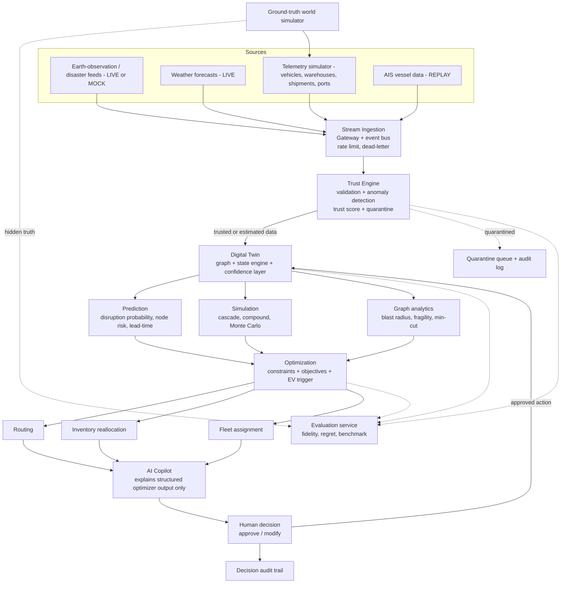

# PNT1 — Addendum A: Telemetry Simulation, Data Trust Engine, Event-Driven Decisions

> **Relationship to the main brief:** This file extends `docs/00_BRIEF.md`. Save it as `docs/00a_ADDENDUM_TELEMETRY_TRUST.md`. Where this addendum is more specific than the main brief, **this addendum wins** for telemetry, trust scoring, and the ingestion-to-decision flow. Everything else in the main brief still applies, including the working rules (Section 0), the MoSCoW scheme, the LIVE/REPLAY/MOCK labelling policy, and the Level 1 acceptance criteria.
>
> **Instruction to Claude Code:** Read the main brief first, then this addendum. Fold this content into the Level 1 deliverables (mapping in Section 10). Do not create a separate parallel design. Record any conflict you resolve in `docs/ASSUMPTIONS.md`.

---

## 1. Why this addendum exists

The main brief treats ingestion and trust at a high level (F-03, F-10 to F-17, F-60). This addendum specifies:

1. A **telemetry catalog**: exactly what signals the twin ingests, since we use no physical IoT hardware.
2. A **telemetry simulator** that generates those signals from the hidden ground-truth world, with noise and injectable attacks.
3. A **Data Trust Engine**: per-signal confidence, aggregation into an entity trust score, and the action taken at each level.
4. An **event-driven decision chain**: telemetry patterns (e.g. many trucks stopping) that automatically trigger detection → prediction → simulation → optimization → recommendation.
5. An updated **end-to-end architecture flow** that adds an AI Copilot stage and fleet optimization.

---

## 2. Telemetry catalog (what the twin ingests)

All telemetry is synthetic, generated by the simulator in Section 3. Priority: **M** = MUST, **S** = SHOULD, **C** = COULD.

### 2.1 Vehicle telemetry
| Signal | Unit / type | Typical rate | Plausible range (for validation) | Pri |
|---|---|---|---|---|
| GPS coordinates | lat, lon (WGS84) | 1 per 5–30 s | Within India bounding box; on or near road graph | M |
| Speed | km/h | with GPS | 0–100 (truck), hard cap 120 | M |
| Direction / heading | degrees 0–360 | with GPS | consistent with movement vector | S |
| Vehicle capacity / load | kg or units | on change | 0 ≤ load ≤ rated capacity | M |
| Fuel level | % | 1 per min | 0–100, monotonic decrease except refuel events | S |
| Engine temperature | °C | 1 per min | 60–115 | C |
| Brake status | enum | on change | ok / warning | C |
| Cargo temperature | °C | 1 per min (cold chain only) | per-cargo band | C |
| Driver hours | h | on change | 0–14, legal limit check | S |

### 2.2 Warehouse telemetry
| Signal | Unit / type | Rate | Validation | Pri |
|---|---|---|---|---|
| Inventory level (per SKU) | units | on change or 1 per min | 0 ≤ qty ≤ capacity; delta consistent with recorded in/out flows | M |
| Storage capacity | units | static/rare | > 0 | M |
| Loading/unloading rate | units/h | 1 per min | ≤ dock throughput | S |
| Temperature, humidity | °C, % | 1 per min | sensor range | C |
| Power status | enum | on change | ok / backup / down | S |

### 2.3 Shipment telemetry
| Signal | Type | Rate | Pri |
|---|---|---|---|
| Location | derived from assigned vehicle | continuous | M |
| Current ETA (+ uncertainty band) | timestamp, hours | recomputed on state change | M |
| Route (ordered link IDs) | list | on change | M |
| Cargo type, priority, status | enums | on change | M |

### 2.4 Port telemetry
| Signal | Type | Rate | Pri |
|---|---|---|---|
| Port congestion | index 0–1 or queue length | 1 per 5 min | M |
| Vessel arrivals | events | `REPLAY` AIS sample | S |
| Container volume | TEU | hourly | S |
| Loading capacity | TEU/h | static/rare | S |
| Operational status | enum open / restricted / closed | on change | M |

### 2.5 Weather / environment
Rainfall, wind, storm category per corridor and per node, from Open-Meteo (`LIVE`) with a cached replay fallback. Operational status flags derived from thresholds. Pri: M.

**Deliverable:** Put this catalog, with a JSON Schema per signal, in `04_DATA_MODEL.md`. Include the validation range in each schema.

---

## 3. Telemetry simulator specification

The simulator is part of the **ground-truth world** (brief F-60). It knows the true state; it emits **observations** with noise and, on command, attacks.

### 3.1 Requirements
- **T-01 (M)** Generate per-vehicle GPS/speed streams that follow the road graph (vehicles move along real link geometry with speed profiles, stops, and traffic variation).
- **T-02 (M)** Generate warehouse inventory feeds from true stock movements (inbound, outbound, orders), emitting observations with configurable measurement noise and missing-update probability.
- **T-03 (M)** Generate shipment and port telemetry consistent with vehicles and network status.
- **T-04 (M)** Configurable throughput: target at least **5,000 events/min** in the presentation, scalable to a load-test target defined in NFRs (Level 4).
- **T-05 (M)** **Seeded and deterministic** for benchmarking; a run ID reproduces the exact stream.
- **T-06 (M)** **Attack injectors**, each callable from the Attack Center UI and from the benchmark harness:
  | Injector | Behaviour |
  |---|---|
  | `gps_spoof_teleport` | Sudden jump to an impossible location (e.g. into the sea) |
  | `gps_spoof_drift` | Gradual offset along a plausible-looking but wrong path (harder to catch) |
  | `speed_spike` | Reported speed far above physical limit (e.g. 780–812 km/h) |
  | `inventory_fake` | Inventory reported higher/lower than truth |
  | `feed_corrupt` | Field values garbled, types wrong, units swapped |
  | `payload_incomplete` | Missing fields, nulls, truncated records |
  | `duplicate_replay` | Old messages re-sent (replay attack) |
  | `entity_blackout` | One source stops sending |
  | `mass_blackout` | Large fraction of sources stop sending |
  | `coordinated_stop_spoof` | Many trucks falsely report stopped (attempts to fake a road blockage) |
- **T-07 (S)** Replay mode: stream a recorded file (used for AIS and as the offline-presentation fallback).
- **T-08 (M)** Every generated observation carries a hidden **ground-truth label** (`is_attacked`, `true_value`) stored separately from the stream so the evaluation service can score detection without leaking labels to the twin.

### 3.2 Event format (minimum)
```json
{
  "event_id": "uuid",
  "source_id": "truck-T104",
  "source_type": "vehicle|warehouse|shipment|port|weather",
  "ts_event": "ISO-8601",
  "ts_ingested": "ISO-8601",
  "seq": 18233,
  "payload": { "lat": 17.38, "lon": 78.48, "speed_kmh": 62, "heading": 91 },
  "signature": "optional HMAC for source authentication"
}
```
`seq` and `event_id` support duplicate/replay detection. The optional signature supports the Level 3 security story.

---

## 4. Data Trust Engine (specification)

This replaces and expands brief F-10 to F-14 and Section 8.1.

### 4.1 Principle
**Reason about telemetry; do not merely display it.** Every incoming data point gets a per-check confidence. Checks aggregate into an **entity trust score**. The score decides whether the value updates the twin, is quarantined, or is used only with a widened uncertainty band.

### 4.2 Check families
| Family | What it asks | Examples | Pri |
|---|---|---|---|
| Schema/structure | Is the payload complete and well-typed? | Missing fields, wrong types, unit mismatch | M |
| Range/physics | Is the value physically possible? | Speed > vehicle limit; implied speed between two fixes; impossible jump distance | M |
| Kinematic consistency | Do successive fixes agree with speed and heading? | Position delta vs reported speed × dt | M |
| Road-network consistency | Can a truck be at this location? | Off-road, in water, not reachable from last trusted position within Δt | M |
| Route consistency | Does it match the assigned route/corridor? | Deviation from route links | M |
| Temporal integrity | Fresh and ordered? | Stale timestamp, out-of-order `seq`, duplicate `event_id` | M |
| Cross-signal | Do related signals agree? | Fuel drop vs distance; inventory delta vs recorded flows; cargo load vs capacity | S |
| Independent context | Does outside evidence agree? | Truck "moving normally" through a corridor flagged flooded; gate-scan event vs GPS; AIS position vs supplier-reported ETA | S (weather), S (gate scan), C (AIS) |
| Source reputation | How reliable has this source been? | Rolling anomaly rate per source | S |
| Statistical anomaly | Is this out of pattern? | Isolation Forest on feature vectors (speed, accel, heading change) | S |

### 4.3 Important honesty rule (corrects an earlier framing)
Do **not** present "satellite position" as an independent truth source for a truck's location. GPS is the vehicle's own telemetry. The defensible independent evidence is:
- the **road network** (is the position physically reachable/plausible),
- the **last trusted state** (continuity),
- **environmental context** (weather / disaster feeds / a pre-processed flood mask, labelled `MOCK` if pre-computed),
- **event evidence** (port gate scans, weigh-bridge events), and
- **AIS** for vessels (`REPLAY`).

In the UI, label the check **"Geospatial / road-network match"**, not "satellite match". If a mocked flood-mask check is shown, label it `MOCK`.

### 4.4 Aggregation into a trust score
Define in the SRS and implement later:

1. Each check `i` yields a confidence `c_i ∈ [0,1]` and a weight `w_i` (weights configurable, documented).
2. **Hard-fail rule:** if any *physics/network hard check* fails (e.g. implied speed above the hard cap, position unreachable), cap the entity's per-reading trust at a low ceiling (e.g. ≤ 0.25) regardless of the other checks. A weighted average alone would let consistent secondary signals mask an impossible position.
3. Reading trust = `min(hard_cap, Σ w_i·c_i / Σ w_i)`.
4. **Entity trust** is a state machine over readings: multiplicative decay on anomalous readings, slow additive recovery over consecutive consistent readings, with a cooldown so one good reading cannot instantly restore trust after an attack.
5. Include the **reasons list** (which checks failed) with every score. The UI must show why.

| Trust | Class | Twin behaviour |
|---|---|---|
| ≥ 0.80 | Trusted | Update twin normally |
| 0.50 – 0.80 | Estimated | Update with widened uncertainty; optimizer applies a discount |
| < 0.50 | Quarantined | Do **not** update the twin; restore/keep last trusted state; flag for review |

Provide a **worked numeric example** for each of these (in the SRS or architecture doc):
- Normal truck (trust ≈ 93%).
- Teleport spoof (hard-fail cap applies; trust ≈ 20%; quarantined).
- Subtle drift spoof (slowly degrading route consistency; shows why a statistical and route check is needed).
- Coordinated multi-truck stop spoof (see Section 5.3).

The numbers in any example are illustrative. The product must compute them.

### 4.5 Actions on quarantine
1. Reject the reading from twin state; keep last trusted position; grow the position-uncertainty radius with elapsed time.
2. Emit `trust.anomaly` with entity, reasons, confidence.
3. If the entity's shipment ETA depends on this data, mark the ETA as degraded and widen its band.
4. Trigger **optimizer re-run** only if the quarantine changes the decision inputs (avoid alert storms).
5. Write an audit entry.
6. Surface in the Trust Monitor and the alert feed (subject to alert triage, F-47).

### 4.6 Comparison presentation (brief F-17)
The engine must support running the optimizer twice on the same scenario: once with **raw** (attacked) data, once with **trusted** data, and display the difference in decision and cost. This is the strongest proof that the trust layer matters.

### 4.7 Handling incomplete payloads and blackouts (PDF P4)
- Missing or nulled fields: use last trusted value, mark field stale, lower reading trust, never throw.
- Dead-letter queue for unparseable messages, with counters.
- Source-level and network-level **data freshness** tracked; thresholds drive the `NORMAL/DEGRADED/BLIND/RECOVERY` modes in brief Section 8.2. Define freshness thresholds numerically.
- The ingestion pipeline must be **crash-safe**: no single malformed message may stop processing. Include this as an explicit NFR with a fuzz test.

---

## 5. Event-driven decisions (telemetry → action)

### 5.1 The chain
```
Telemetry event
  → validation + trust scoring
  → pattern detection (spatial-temporal)
  → cause inference (check external context)
  → twin state update (e.g. road status)
  → risk prediction
  → scenario simulation
  → optimization
  → recommendation (human approves)
```

### 5.2 Canonical example: road blockage inferred from telemetry
1. Speed of several trucks on the same link drops to ~0.
2. Pattern detector finds a **spatial-temporal cluster**: ≥ N trusted vehicles within radius R on the same link with speed < threshold for ≥ T minutes.
3. Cause inference checks weather/disaster context and historical stop patterns (distinguishing a blockage from a scheduled rest stop or toll queue).
4. Twin updates the link status to `BLOCKED (inferred)` with a confidence value.
5. Risk prediction and cascade simulation run for that link.
6. Optimizer proposes new routes for affected shipments.
7. Operator sees the recommendation with the evidence shown.

Define N, R, T as configurable parameters with defaults and document them.

### 5.3 Adversarial guard on the inference chain
This chain is itself an attack surface: an attacker could **spoof many trucks stopping** to fake a blockage and force a bad reroute. Therefore:
- Only readings above the trust threshold count toward the cluster; the quorum is **trust-weighted**.
- Require corroboration from at least one independent signal (weather/alert context, non-GPS evidence such as gate scans, or vehicles from independent fleets/sources) before auto-marking a link blocked with high confidence; otherwise mark as `SUSPECTED` and request human confirmation.
- The benchmark must include the `coordinated_stop_spoof` scenario and score whether the system avoided a false reroute.

### 5.4 Automatic vs human-approved
Inference and simulation run automatically. **Executing** a reroute or transfer always requires human approval in the MVP (brief F-44). Define an `auto_action_policy` config (off by default) only as a documented future extension.

---

## 6. Live telemetry dashboard (computed KPIs)

The Control Room must show a **Live Telemetry panel** with values **computed from the actual stream**, never hardcoded:

- Events per minute (rolling).
- % valid vs invalid.
- Anomaly count (by severity).
- Critical events count.
- Quarantined entities count.
- Dead-letter count.
- Data freshness % (sources updated within threshold).
- Current network mode (`NORMAL/DEGRADED/BLIND/RECOVERY`).

Each figure links to a drill-down (anomaly list, quarantine queue).

### 6.1 Trust card (per entity, in Node Detail and Trust Monitor)
A card showing each check family's confidence, the aggregated trust score, the class (Trusted/Estimated/Quarantined), the list of failed checks with reasons, and a trust-over-time chart. Checks that use mocked data are visibly labelled `MOCK`.

### 6.2 "Inject telemetry anomaly" presentation control
A button in the Attack Center that calls an injector from T-06. The UI must show, within seconds:
1. The raw injected value (e.g. reported speed 812 km/h vs expected max 95 km/h).
2. Failed checks and their reasons.
3. Trust score drop and class change.
4. Action taken: quarantined, last trusted position restored.
5. Optimizer re-run **only if** decision inputs changed, with before/after comparison.

---

## 7. Updated end-to-end architecture flow

Use this as the authoritative flow diagram (render in Mermaid in `02_ARCHITECTURE.md` and `03_DATA_FLOW.md`). It adds an **external signal branch**, an explicit **Trust Engine**, **fleet optimization**, and an **AI Copilot** stage.



**Notes Claude Code must reflect in the docs:**
- The Copilot receives **structured optimizer output and trust/evidence data only**. It never chooses routes or computes numbers.
- The quarantine path never writes to twin state.
- The evaluation service receives hidden truth and labels that the twin and UI never see.
- Earth-observation and satellite inputs are labelled `LIVE`, `REPLAY` or `MOCK` per source in the diagram legend.
- "Kafka / WebSockets" in the original sketch is interpreted as: **event bus** (Kafka/Redpanda or Redis Streams, decided in `06_TECH_STACK.md`) for backend ingestion, and **WebSocket/SSE** for pushing live state to the UI.

---

## 8. Fleet optimization (added branch)

The main brief has routing and inventory optimization; add **fleet** as a third branch:

- **F-80 (S)** Vehicle-to-shipment assignment and re-assignment when routes change, respecting vehicle capacity, current location (trusted position), and remaining driver hours.
- **F-81 (S)** Driver-hours constraint enforcement (legal limit), with a warning when a reroute would push a driver over the limit.
- **F-82 (C)** Fleet shortage detection during cascades (demand spike plus vehicle unavailability), feeding the cascade simulator.

MUST-level optimization remains routing plus inventory reallocation. Fleet is SHOULD so the slice stays achievable.

---

## 9. New and changed requirements (IDs to add to the SRS)

| ID | Requirement | Pri | Source |
|---|---|---|---|
| T-01 to T-08 | Telemetry simulator (Section 3.1) | M/S | ENH |
| F-90 | Telemetry catalog with per-signal schema and validation ranges | M | ENH |
| F-91 | Trust Engine with check families, hard-fail rule, entity state machine | M | ENH |
| F-92 | Trust card with per-check confidence and failed-check reasons | M | ENH |
| F-93 | Spatial-temporal pattern detection for inferred road blockage | M | ENH |
| F-94 | Trust-weighted quorum and independent-corroboration guard for inferred events | M | ENH |
| F-95 | Live telemetry panel with computed KPIs | M | ENH |
| F-96 | Duplicate/replay detection via `event_id` and `seq` | S | ENH |
| F-97 | Optional message signing (HMAC) for source authentication | C | ENH |
| F-98 | Crash-safe ingestion with fuzz test (no message can halt the pipeline) | M | PDF P4 |
| F-80 to F-82 | Fleet optimization (Section 8) | S/C | ENH |

**Traceability:** Map F-90 to F-98 and T-01 to T-08 to PDF requirements **P1** (high-throughput ingestion, synchronized telemetry), **P3** (real-time visibility), **P4** (adversarial resilience), and **P5** (evaluation labels).

---

## 10. Where to fold this into the Level 1 documents

| Level 1 file | What to add |
|---|---|
| `01_SRS.md` | Requirements in Section 9; use cases for telemetry anomaly (UC-05) and inferred blockage (new UC-10); NFRs for ingestion throughput and crash-safety |
| `02_ARCHITECTURE.md` | Section 7 diagram; Trust Engine and Telemetry Simulator as named components; Copilot and Fleet branches |
| `03_DATA_FLOW.md` | Trust pipeline with quarantine path; event-driven decision chain (Section 5.1); blockage inference sequence; adversarial guard |
| `04_DATA_MODEL.md` | Telemetry catalog and JSON Schemas (Section 2); event envelope (Section 3.2); `TrustState` extended with per-check confidences and reasons; `InferredEvent` entity (link status + confidence + evidence) |
| `05_UI_WIREFRAMES.md` | Live Telemetry panel; Trust card; Inject Telemetry Anomaly flow (Section 6); update Attack Center with all injectors in T-06 |
| `06_TECH_STACK.md` | Justify event bus choice; anomaly model choice (rules plus Isolation Forest); HMAC library if F-97 selected |
| `07_ROADMAP.md` | Schedule the telemetry simulator early (it is on the critical path for the trust presentation and benchmark); Trust Engine after the simulator |
| `08_EVALUATION_FRAMEWORK.md` | Add per-injector detection metrics (detection rate, false positives, time-to-detect); add `coordinated_stop_spoof` and `gps_spoof_drift` to the benchmark; add ingestion throughput and crash-safety metrics |
| `09_WALKTHROUGH_SCRIPT.md` | Use the "Inject telemetry anomaly" flow as the live adversarial presentation beat |
| `10_RISKS_AND_SCOPE.md` | Add: detector false positives; subtle drift evading detection; overclaiming satellite as an independent position source; inferred-blockage false positives |

---

## 11. Acceptance criteria for this addendum

Level 1 is not complete unless:

1. The telemetry catalog (Section 2) appears in `04_DATA_MODEL.md` with a JSON Schema and validation range per signal.
2. The simulator spec (Section 3) is reflected in architecture, roadmap, and evaluation docs, including all ten injectors.
3. The Trust Engine spec covers check families, the hard-fail rule, the trust state machine, thresholds, quarantine actions, and worked examples for normal, teleport, drift, and coordinated-stop cases.
4. No document describes satellite data as an independent vehicle-position source; the check is named "geospatial / road-network match" and any mocked context check is labelled `MOCK`.
5. The Section 7 diagram is present in both the architecture and data-flow docs and renders as valid Mermaid.
6. The blockage-inference chain includes the trust-weighted quorum and independent-corroboration guard.
7. The Live Telemetry panel states that every KPI is computed from the stream.
8. Fleet optimization is present and marked SHOULD/COULD, with routing and inventory remaining the MUST-level optimizer outputs.
9. Every new requirement in Section 9 appears in the traceability matrix.
10. `docs/LEVEL1_CHECKLIST.md` includes a pass/fail row for each item above.
