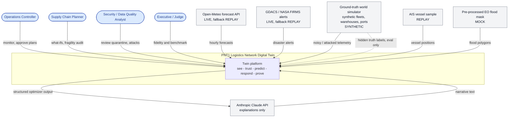
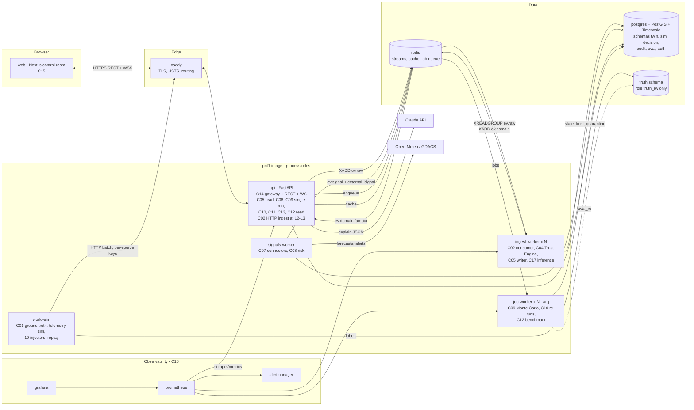
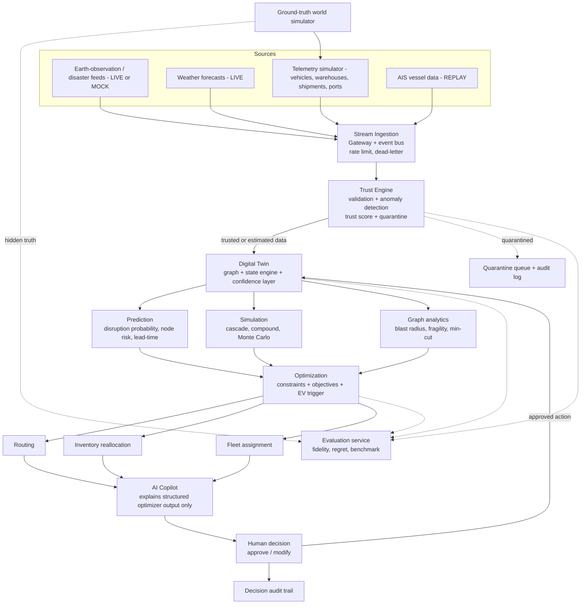
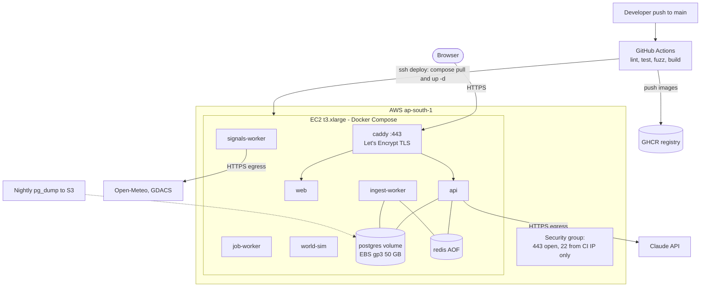
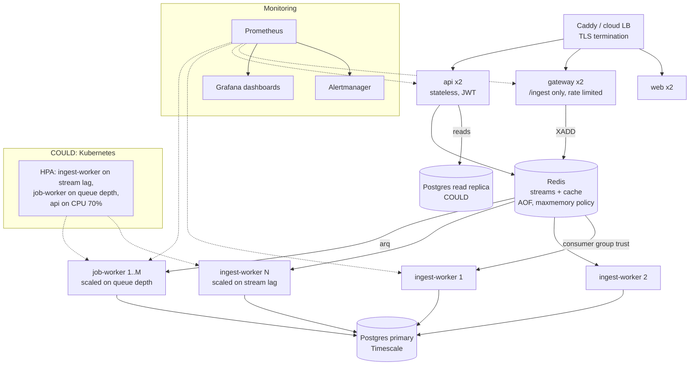

# 02 — System Architecture

> *"A logistics twin that sees trouble coming, knows which data to trust, and can prove how accurate it is."*

Contents: §1 architectural style · §2 diagrams (context, containers, authoritative end-to-end flow, deployment L3/L4) · §3 module-to-container map · §4 component specifications C01–C17 · §5 Trust Engine algorithm with worked examples · §6 cascade and Monte Carlo · §7 optimizer · §8 EV trigger and probability calibration · §9 structural fragility and resilience score · §10 cross-cutting concerns.

Diagram index (BRIEF §7.3). This file has #1, #2, #9 and the ADD §7 flow. `03_DATA_FLOW.md` has #3–#8 and the ADD §7 flow again.

---

## 1. Architectural style: modular monolith

**Decision:** one Python code base (`pnt1`) with strict module boundaries. It runs as a small number of **process roles** (containers) built from one image, plus a separate Next.js frontend.

**Why:**
1. A 4-person team in 21 days cannot afford to run 16 microservices (inter-service auth, contracts, tracing).
2. The modules share heavy in-memory state (the NetworkX graph and twin snapshot). A monolith avoids serialising it across the network for every simulation.
3. The boundaries are still real. Modules talk only through (a) typed Python interfaces (`pnt1.<module>.api`) and (b) events on the bus. That makes the Level 4 split mechanical.
4. The hidden ground-truth world (C01) **is** a separate process and database role from day 1, because isolation is a correctness requirement (F-60) and not a scaling one.

**Enforcement:** an `import-linter` contract in CI forbids cross-module imports except through `pnt1.<module>.api`, and forbids any import of `pnt1.world` or `pnt1.truth` from twin-side modules.

**Level 4 split plan:** `ingest-worker` (C02 consumer + C04 + C05 writer + C17) and `job-worker` (C09/C10/C12) scale horizontally first. The gateway (C02 HTTP) splits off from `api` next. The optimizer becomes its own container only if solve times need CPU isolation.

---

## 2. Diagrams

### 2.1 Diagram #1: System context (C4 level 1)



### 2.2 Diagram #2: Containers and components (C4 level 2)



### 2.3 Authoritative end-to-end flow (ADD §7), shown in both 02 and 03

**Legend (data modes):** Earth-observation flood mask = `MOCK`. Disaster feeds (GDACS/FIRMS) = `LIVE` with `REPLAY` fallback. Weather = `LIVE` with `REPLAY` fallback. AIS = `REPLAY`. Telemetry simulator = synthetic, from the ground-truth world.



**Invariants shown by this diagram:**
- The Copilot (C13) receives **only** structured optimizer output plus trust and evidence data. It never chooses routes or computes numbers.
- The quarantine path **never** writes to twin state.
- The evaluation service receives hidden truth and labels that the twin and UI never see.
- "Kafka / WebSockets" in the original sketch means: an **event bus** (Redis Streams at L2–L4, with Redpanda as a drop-in; see `06_TECH_STACK.md`) for backend ingestion, and **WebSocket** (SSE fallback) for pushing live state to the UI.
- Routing and Inventory reallocation are **MUST**. Fleet assignment is **SHOULD** (F-80/81) or **COULD** (F-82).

### 2.4 Diagram #9a: Deployment, Level 3 (cloud launch)



### 2.5 Diagram #9b: Deployment, Level 4 (scaled)



At L4 the default is Docker Compose with `--scale ingest-worker=N --scale job-worker=M` on a larger VM. The Kubernetes manifests plus HPA (F-75) are COULD.

---

## 3. Module-to-container map

| Module (package) | Component | Container(s) | Splits at L4? |
|---|---|---|---|
| `pnt1.world` | C01 Ground-truth world + telemetry simulator | `world-sim` | Already separate |
| `pnt1.ingest` | C02 Ingestion gateway | `api` (HTTP), `ingest-worker` (consumer) | Yes → `gateway` |
| `pnt1.bus` | C03 Event bus adapter | library in all roles | Swap Redis → Redpanda |
| `pnt1.trust` | C04 Trust & validation (Trust Engine) | `ingest-worker` | Scales with ingest |
| `pnt1.twin` | C05 Twin state | writer in `ingest-worker`, reader in `api` | No (single writer per entity partition) |
| `pnt1.graph` | C06 Graph analytics | `api` (cached) | No |
| `pnt1.signals` | C07 External signal service | `signals-worker` | No |
| `pnt1.risk` | C08 Risk / prediction | `signals-worker`, `api` | No |
| `pnt1.sim` | C09 Simulation (cascade, Monte Carlo) | `api` (single cascade), `job-worker` (MC) | Scales with jobs |
| `pnt1.opt` | C10 Optimization (routing, inventory, fleet) | `api`, `job-worker` | Maybe → `optimizer` |
| `pnt1.decision` | C11 Decision / audit | `api` | No |
| `pnt1.eval` | C12 Evaluation | `job-worker` (benchmark), `api` (read) | No |
| `pnt1.explain` | C13 Explanation / AI Copilot | `api` | No |
| `pnt1.api` | C14 API gateway / backend | `api` | Replicas |
| `frontend/` | C15 Frontend | `web` | Replicas |
| infra | C16 Observability | `prometheus`, `grafana`, `alertmanager` | — |
| `pnt1.inference` | C17 Event inference (pattern detection + cause inference) | `ingest-worker` | Scales with ingest |

---

## 4. Component specifications

Each component lists: **Responsibility · Inputs · Outputs · Interfaces · Scaling · Failure behaviour**.

### C01 Ground-truth world simulator and telemetry simulator
- **Responsibility:** holds the *true* state of the synthetic world (vehicle kinematics along link geometry, true inventory, true demand, true link and port status, true disruptions). Emits **observations** of it with configurable noise, missing-update probability and injected attacks (T-01…T-08). Replays recorded files (AIS, offline presentation; T-07).
- **Inputs:** `seed_network.yaml`, run config (seed, clock speed, noise profile), scenario scripts (e.g. "rain on HYD-VGA at T+8h"), attack commands from the Attack Center (`POST /world/attacks`, Admin/Operator) and the benchmark harness.
- **Outputs:** envelopes to the ingestion gateway over HTTPS, using the same path as any external source. `truth.*` rows and `observation_label` records go to the `truth` schema.
- **Interfaces:** `WorldControl` (start/pause/speed/seed), `Injector.inject(kind, targets, params, duration)`, `Replay.play(file, speed)`.
- **Ten injectors (T-06):** `gps_spoof_teleport`, `gps_spoof_drift`, `speed_spike`, `inventory_fake`, `feed_corrupt`, `payload_incomplete`, `duplicate_replay`, `entity_blackout`, `mass_blackout`, `coordinated_stop_spoof`.
- **Scaling:** a vectorised NumPy step (1 s of sim time per tick) for 120 vehicles. It emits ≥ 5,000 events/min at presentation settings (T-04) and up to 60,000 events/min in load-test mode (more vehicles, higher rate).
- **Failure:** if the gateway is unreachable, it buffers up to 60 s and then drops the oldest events. Drops are recorded as a truth-side "blackout" so evaluation stays honest. It is deterministic given `(seed, run_id, command log)` (T-05).

### C02 Ingestion gateway
- **Responsibility:** authenticated entry point for all sources. Checks the envelope schema, size limit, source key, optional HMAC (F-97) and rate limit, then does dedupe pre-checks and hands off to the bus. Malformed data goes to the dead-letter queue. It is **crash-safe** (F-98): every message is handled inside an isolated try/except, and no exception can escape the batch loop.
- **Inputs:** `POST /ingest/batch` (≤ 500 envelopes, ≤ 16 KB each) with header `X-Source-Key`. Connector pushes from C07.
- **Outputs:** `XADD ev.raw`, `twin.telemetry_raw` (async batch insert), `twin.dead_letter`, metrics (`ingest_events_total{status}`).
- **Interfaces:** HTTP; `Bus.publish(stream, envelope)`.
- **Scaling:** stateless, so it scales horizontally behind Caddy. The Redis token bucket is per source key.
- **Failure:** if the bus is unavailable, it returns `503` with `Retry-After` and the sources retry. If Postgres is unavailable, raw persistence is buffered and ingest continues. Unknown fields are rejected to the DLQ (`additionalProperties: false`).

### C03 Event bus
- **Responsibility:** durable, ordered-per-stream delivery with consumer groups. Streams are defined in `04_DATA_MODEL.md` §6.3.
- **Interfaces:** `Bus.publish`, `Bus.subscribe(group, consumer)`, `Bus.ack`. Implementations: `RedisStreamsBus` (L2–L4), `RedpandaBus` (documented swap).
- **Scaling:** partitioned by `hash(source_id) mod P` into P sub-streams (`ev.raw.{p}`) at L4, so each entity is handled by one consumer and its trust state machine stays serial.
- **Failure:** pending-entries list (PEL) claim after 30 s if a consumer dies. Idempotency comes from `event_id`, stored in a Redis set with a 10 min TTL.

### C04 Trust & validation service (Data Trust Engine)
- **Responsibility:** for each reading, run the check families, compute the reading trust ρ (with the hard-fail cap), update the entity trust τ (state machine with cooldown), classify it (Trusted / Estimated / Quarantined), attach reasons, and decide the action (update twin, update with widened uncertainty, or quarantine and restore the last trusted state). It also computes source- and network-level freshness and drives the network mode (NORMAL/DEGRADED/BLIND/RECOVERY). Full algorithm in §5.
- **Inputs:** `ev.raw`, road geometry (PostGIS / in-memory STRtree), shipment route assignments, last trusted state (C05), context signals (C07), the IsolationForest model artifact.
- **Outputs:** accepted readings with `trust_class` and uncertainty go to C05. Quarantined readings go to `twin.quarantine_item`. It also writes `trust_history` and `trust_state`, and publishes `trust.anomaly` and `mode.changed` on `ev.domain`, and `audit_log` entries.
- **Interfaces:** `TrustEngine.evaluate(envelope) -> TrustVerdict{rho, tau, class, checks{}, reasons[], action}`; `ModeController.tick()`.
- **Scaling:** entity-partitioned (C03) so the state machine per entity is single-writer. The checks are O(1) per reading except the road match, which uses an STRtree lookup, O(log n).
- **Failure:** if a check throws, that check gets confidence 0.5 and the reason `check_error:<name>`, and the reading continues. If the context signal is unavailable, the check is excluded and weights are renormalised. The engine never blocks the stream.

### C05 Twin state service
- **Responsibility:** the twin's *belief*. Holds the NetworkX graph plus live state (vehicle trusted positions and uncertainty, shipments and ETAs with bands, inventory with `qty_reported`/`qty_verified`/confidence, link and node status, orders). It also keeps versioned snapshots for simulation and audit.
- **Inputs:** trusted or estimated readings from C04, inference results from C17, approved actions from C11, external signal effects from C08.
- **Outputs:** `twin.state_changed` diffs (published at 1 Hz, coalesced) to the UI, snapshots (`snapshot_version`) to C09/C10, and Postgres current-state tables.
- **Interfaces:** `Twin.snapshot() -> TwinSnapshot`, `Twin.apply(reading)`, `Twin.apply_action(plan)`, `Twin.reconcile(source_id)` (RECOVERY).
- **Confidence layer:** position uncertainty r(t) = r₀ + v_typ · age (r₀ = 0.05 km, v_typ = 45 km/h, capped at the link length). ETA band σ_ETA(t) = √(σ₀² + (0.5 · age_h)²), with σ₀ = 0.25 h. Inventory confidence = the source's τ times a staleness factor e^(−age_h/6).
- **Scaling:** a single logical writer per entity partition. Readers use immutable snapshots, copy-on-write every 1 s.
- **Failure:** on restart it rebuilds from Postgres current-state tables plus the tail of `ev.raw`, replayed from the last checkpointed stream ID.

### C06 Graph analytics service
- **Responsibility:** fragility audit (articulation points, betweenness centrality weighted by flow, supplier→customer-cluster min-cut, % downstream flow per node), blast radius per node, resilience score and sub-scores, and the "add a link" what-if. Algorithms in §9.
- **Inputs:** twin snapshot (topology, capacities, current flows).
- **Outputs:** `FragilityReport`, `BlastRadius`, `ResilienceScore`. They are cached in Redis for 60 s or until the topology changes.
- **Scaling:** 40 nodes, so each call takes milliseconds.
- **Failure:** pure functions, no side effects. If something goes wrong it returns the last cached report with `stale: true`.

### C07 External signal service
- **Responsibility:** connectors for Open-Meteo (`LIVE`), GDACS/FIRMS (`LIVE`), AIS (`REPLAY`) and the EO flood mask (`MOCK`). Samples 3–6 points per corridor, normalises the data into `signal.*` envelopes, records every live response to a replay cache, and serves replay when the live source fails.
- **Inputs:** corridor sample points (derived from link geometry), polling schedule (30 min weather, 15 min alerts).
- **Outputs:** envelopes to C02 (the same path as the telemetry) and rows in `twin.external_signal` with `data_mode`.
- **Failure:** tenacity retry (3 attempts, exponential backoff). After that it falls back to the latest replay with `data_mode = REPLAY`, and the UI badge shows "REPLAY". It never fabricates a `LIVE` label.

### C08 Risk / prediction service
- **Responsibility:** turns forecasts into **corridor disruption probability** (§8.2). Also produces per-node risk scores with explainable drivers (F-25), lead-time multipliers per corridor and season (F-24, S), and inventory trend projections.
- **Inputs:** `signal.weather`, `signal.alert`, twin snapshot, historical delay/weather pairs from the world run log.
- **Outputs:** `RiskAssessment{corridor_id, p, horizon_h, drivers[], calibration_version}`. When p crosses the EV-relevant threshold (default 0.2) for any corridor carrying active flow, it raises a proactive trigger.
- **Failure:** if no fresh forecast is available, it uses the last forecast with a probability decay toward the climatological base rate (half-life 3 h) and flags `stale_forecast`.

### C09 Simulation service
- **Responsibility:** discrete-time cascade engine (1 h step, 72 h horizon) with compound failures, plus a Monte Carlo runner (200 seeded runs). It outputs timelines, orders at risk, stockout times, cost, delay, P50/P90 and robustness. Algorithm in §6.
- **Inputs:** `TwinSnapshot`, `Scenario{type, params, seed}`, a strategy plan (for evaluating strategies).
- **Outputs:** `SimulationRun` (stored in `sim.simulation_run`) and `scenario.run` events. Timeline frames are streamed to the UI for the scrubber.
- **Scaling:** a single cascade runs in the API thread pool (≤ 2 s). Monte Carlo runs on `job-worker` (vectorised across runs, ≤ 15 s at L2/L3 and ≤ 8 s at L4).
- **Failure:** the runtime is watchdog-bounded. If it overruns, it returns partial runs with `n_completed` and the UI shows a reduced-confidence badge.

### C10 Optimization service
- **Responsibility:** constraint-aware multi-objective planning: routing (M), inventory reallocation (M), fleet assignment (S). Generates the four strategies (do nothing / reroute / transfer / hybrid). Applies the EV trigger (§8) and the trust discount on inventory. Formulation in §7.
- **Inputs:** snapshot, simulation results, risk p, objective preset, user modifications (F-44).
- **Outputs:** `Recommendation` + `Strategy[]` with `constraint_checks`, `solver_status`, `ev{}`.
- **Failure:** 5 s solver time limit. If it times out, the best feasible solution is used (`feasible_timeout`). If the solve is infeasible or hits an error, it falls back to the heuristic (`heuristic_fallback`, ≤ 1 s). The output always includes `solver_status`, so the UI can show it.

### C11 Decision / audit service
- **Responsibility:** human-in-the-loop workflow (approve / modify / reject), applying approved plans to the twin (and to the world simulator's dispatcher, which simulates execution), the append-only hash-chained audit log, and replay of any past decision (it re-runs the optimizer on the stored `inputs_snapshot` and `trust_snapshot` and diffs the result).
- **Inputs:** `recommendation.created`, operator actions (`POST /decisions`, Operator+).
- **Outputs:** `decision.approved`, `audit_log`, action commands to C05 and C01.
- **Failure:** approval is transactional: the decision row, the audit entry and the outbox event are written in one DB transaction (outbox pattern). The audit chain is verified at startup and by `GET /audit/verify`.

### C12 Evaluation service
- **Responsibility:** compares twin belief with ground truth. Computes fidelity metrics, decision regret (perfect-information optimum), detection metrics per injector, the chaos benchmark suite, and drift over time. It is the only twin-side component with read access to `truth`. Details in `08_EVALUATION_FRAMEWORK.md`.
- **Inputs:** `truth.*` (eval_ro), `twin.*`, `trust_history`, `quarantine_item`, `decision.*`.
- **Outputs:** `eval.evaluation_result`, the Resilience Benchmark table (JSON + Markdown), Grafana metrics.
- **Failure:** benchmark runs are isolated per `run_id`. A failed scenario is recorded as `status=error` and does not stop the suite.

### C13 Explanation service (AI Copilot)
- **Responsibility:** turns the structured optimizer output into a short narrative ("Why this plan"). It **never** computes routes or numbers.
- **Inputs:** a JSON object `{strategies[], chosen, ev{}, constraint_checks[], trust_evidence[], objective}`. No free text from users or telemetry is ever passed in, to avoid prompt injection.
- **Outputs:** narrative text (≤ 150 words) plus a list of the numbers cited.
- **Guardrails:** (1) the system prompt forbids new numbers; (2) a post-validator extracts every number in the output and rejects the narrative if a number is not present in the input JSON (within formatting tolerance); (3) if validation fails, or on timeout (4 s) or missing key, it falls back to a deterministic template. `explanation_source` records which one was used.

### C14 API gateway / backend
- **Responsibility:** REST and WebSocket API, JWT auth, RBAC, rate limiting, OpenAPI docs.
- **Key endpoints:** `POST /auth/login`, `GET /twin/snapshot`, `GET /nodes/{id}`, `GET /nodes/{id}/blast-radius`, `GET /graph/fragility`, `GET /signals/corridors`, `POST /scenarios`, `POST /scenarios/{id}/run`, `GET /runs/{id}`, `POST /recommendations` (compute), `GET /recommendations/{id}`, `POST /decisions`, `GET /trust/entities`, `GET /trust/entities/{id}`, `GET /quarantine`, `POST /quarantine/{id}/review`, `POST /world/attacks` (Operator+), `POST /compare/raw-vs-trusted`, `GET /eval/benchmark`, `GET /eval/fidelity` (Admin), `GET /audit`, `GET /audit/{id}/replay`, `GET /telemetry/kpis`, `WS /ws/live`.
- **Failure:** health endpoints `/healthz` (liveness) and `/readyz` (DB, Redis and bus-lag checks). Clear 4xx/5xx JSON errors that never include stack traces.

### C15 Frontend (control room)
- **Responsibility:** the 12 screens in `05_UI_WIREFRAMES.md`. Live state arrives over WS diffs, and a map with deck.gl layers shows it.
- **Failure:** if the WS disconnects, it shows a "LIVE LINK LOST" banner and reconnects with exponential backoff. The last state stays on screen, greyed out.

### C16 Observability stack
- **Responsibility:** Prometheus metrics (ingest rate, DLQ, stream lag, trust anomalies, mode, API latency histograms, solver time, MC runtime), Grafana dashboards, Alertmanager rules (for example: stream lag > 10 s for 2 min; DLQ rate > 5% for 5 min; mode = BLIND; API p95 > 500 ms; solver fallback rate > 20%), and structured JSON logs.

### C17 Event inference service (pattern detection + cause inference)
- **Responsibility:** spatial-temporal pattern detection over **trusted** readings (F-93), for example "≥ N trusted vehicles within R km on the same link with speed < 5 km/h for ≥ T min". Then cause inference against context (weather, alerts, rest-stop and toll-plaza registry, gate scans), and the adversarial guard (F-94): a trust-weighted quorum, independent-source corroboration and a contradiction check. Produces `inference.link_status` with SUSPECTED or BLOCKED_INFERRED and a confidence value. Algorithm in `03_DATA_FLOW.md` §7.
- **Inputs:** trusted readings (C04 → C05), context from C07/C08, gate scans.
- **Outputs:** `twin.inferred_event`, link status updates to C05 (only `blocked_inferred` changes routing inputs; `suspected` asks for human confirmation), proactive trigger to C09/C10.
- **Failure:** stateless windowing over Redis sorted sets (10 min TTL). If context is missing, it caps at `suspected`.

---

## 5. Trust Engine algorithm (BRIEF §8.1 + ADD §4, authoritative)

### 5.1 Check families and default weights

| # | Family | Symbol | Weight wᵢ | Hard check? | Confidence function cᵢ (defaults) | Pri |
|---|---|---|---|---|---|---|
| 1 | Schema / structure | S | 0.10 | no | 1 − 0.1 × missing optional fields (floor 0.3); 0 if a required field is missing or the wrong type | M |
| 2 | Range / physics | P | 0.20 | **yes** | 1 if reported speed ≤ 100 km/h; linear to 0 at 120 km/h; 0 above the hard cap; 0 if lat/lon is outside India bbox | M |
| 3 | Kinematic consistency | K | 0.20 | **yes** | implied speed v̂ = dist(fixᵢ, last trusted)/Δt. c = 1 if v̂ ≤ 100; linear to 0 at 130 km/h. Also penalises \|v̂ − reported\| > 25 km/h (× 0.8) and heading error > 45° (× 0.9) | M |
| 4 | Road-network / geospatial match | N | 0.15 | **yes** | d = distance to the nearest road geometry: c = e^(−max(0, d − 0.3)/2.0). **0** if the point is inside the water/land-use mask or not reachable from the last trusted position within Δt along the graph | M |
| 5 | Route consistency | R | 0.15 | no | c = e^(−x/1.0), where x = cross-track deviation (km) from the assigned route links. A **CUSUM drift override** applies (§5.4) | M |
| 6 | Temporal integrity | T | 0.10 | no | 0 if a duplicate `event_id` (dropped and counted) or `seq` ≤ last seq; 0.5 if ts_event is more than 5 min old or skewed more than 2 min into the future; else 1 | M |
| 7 | Statistical anomaly | A | 0.05 | no | 1 − IsolationForest anomaly score (features: speed, acceleration, heading change, deviation rate, stop duration), scaled to [0,1] | S |
| 8 | Independent context | C | 0.05 | no | Agreement with context. 0.2 if a vehicle reports normal movement through a corridor with an active red alert or a flood polygon (`MOCK` flag), or if it contradicts an independent gate scan; 0.8 if there is no context; 1 if it is corroborated | S |
| — | Cross-signal (fuel vs distance, inventory Δ vs flows, load ≤ capacity) | X | folded into P (vehicle) or S+P (inventory feeds) | — | inventory: c = 1 if \|Δqty − (in − out)\| ≤ max(5, 2%); linear to 0 at 20% | S |
| — | Source reputation | — | used as a **prior** | — | New entities start at τ₀ = 0.85 × source reputation (rolling 24 h non-anomaly rate of the source) | S |

Warehouse and supplier feeds use S, P (range + capacity), X (flow reconciliation), T, A and C. The vehicle-only checks K, N and R do not apply. Weights are renormalised over the checks that apply.

### 5.2 Reading trust (with the hard-fail rule)

```
avg   = Σ wᵢ·cᵢ / Σ wᵢ                  over active checks
hard  = any(c_P, c_K, c_N < 0.20)       # physics / network hard fail
rho   = min(0.20, avg)  if hard  else avg
rho   = min(0.70, rho)  if cusum ≥ h1   # soft drift alarm  (§5.4)
rho   = min(0.45, rho)  if cusum ≥ h2   # hard drift alarm
```
The hard cap exists because a plain weighted average lets consistent secondary signals hide an impossible reading (see example B below).

### 5.3 Entity trust state machine (with cooldown)

```
on reading with rho:
    if rho < 0.50:                         # hard anomaly
        tau = min(0.5 * tau, rho); good = 0; last_anomaly = now
    elif rho < 0.80:                       # soft anomaly
        tau = tau * (1 - (0.80 - rho)); good = 0; last_anomaly = now
    else:                                  # consistent reading
        good += 1
        if good >= 5 and now - last_anomaly >= 10 sim-min:     # cooldown
            tau = tau + min(0.02, max(0, 0.2 * (rho - tau)))    # slow additive recovery, never above rho
    class = trusted if tau >= 0.80 else estimated if tau >= 0.50 else quarantined
    action:
        trusted     -> twin.apply(reading)
        estimated   -> twin.apply(reading, widen_uncertainty=True); optimizer discount
        quarantined -> quarantine(reading); twin keeps last trusted state; uncertainty grows with age
```

From a quarantined τ = 0.20, getting back to Trusted (0.80) takes ≥ 5 cooldown readings and 10 sim-minutes, plus about 30 consecutive good readings (≈ 8–15 min at 15–30 s intervals). One good reading can never restore trust.

**Optimizer discount:** usable inventory = `qty_verified × d(τ)`, where d = 1 for Trusted, d = τ for Estimated, and d = 0 for Quarantined (only independently verified stock counts). Vehicle availability for fleet assignment uses the trusted position with an uncertainty radius. If the radius is more than 25 km, the vehicle is excluded.

### 5.4 Drift detection (CUSUM, part of Route consistency)

`Sₜ = max(0, Sₜ₋₁ + xₜ − k)`, where xₜ = cross-track deviation (km) from the assigned route, k = 0.2 km, soft alarm h₁ = 1.5, hard alarm h₂ = 3.0. It is reset by an approved reroute or a route-change event. The drift gets past each individual check but not past the cumulative evidence.

### 5.5 Worked examples

> These numbers come from the formulas above with the default weights, so they are *illustrative*. The product computes them at run time (module `pnt1.trust`). They are reproduced by unit tests `TS-TRUST-01…04`.

**A. Normal truck: τ ≈ 0.93, Trusted**

| Check | S | P | K | N | R | T | A | C |
|---|---|---|---|---|---|---|---|---|
| cᵢ | 1.00 | 1.00 | 0.92 | 0.90 | 0.85 | 1.00 | 0.90 | 0.80 |
| wᵢ·cᵢ | 0.100 | 0.200 | 0.184 | 0.135 | 0.1275 | 0.100 | 0.045 | 0.040 |

avg = **0.9315**. No hard fail, so ρ = 0.93. In steady state τ → 0.93 → **Trusted**, and the twin updates normally.

**B. Teleport spoof into the sea: hard-fail cap applies, τ = 0.20, Quarantined**

Truck-A-017 at (17.38, 78.48) reports (15.00, 70.00) 30 s later. That is ~950 km, so the implied speed is about 114,000 km/h. The reported speed of 62 km/h is plausible.

| Check | S | P | K | N | R | T | A | C |
|---|---|---|---|---|---|---|---|---|
| cᵢ | 1.00 | 1.00 | **0.00** | **0.00** (in water) | 0.00 | 1.00 | 0.10 | 0.50 |

avg = 0.43. Hard fail (K and N), so ρ = min(0.20, 0.43) = **0.20**. τ = min(0.5 × 0.93, 0.20) = **0.20**, so the entity is **Quarantined**. Reasons: `kinematic: implied 114000 km/h > 130`, `road_network: position in water mask`, `route: 950 km off assigned route`. Actions: reject the reading, keep the last trusted position, grow the uncertainty radius, mark the shipment ETA as degraded, emit `trust.anomaly`, write audit.

*Why the hard cap matters:* a **speed spike** (reported 812 km/h while the positions are consistent) gives c = {S 1, P 0, K 0.10, N 0.90, R 0.85, T 1, A 0.20, C 0.80}, so **avg = 0.53**. A weighted average alone would have classed an 812 km/h truck as *Estimated* and fed it to the twin. With the hard fail on P, ρ = 0.20 and it is quarantined.

**C. Subtle drift spoof: slow degradation, caught by Route + CUSUM**

`gps_spoof_drift` adds +0.15 km of cross-track offset every 5 minutes along a plausible-looking road-adjacent path. Readings are shown every 5 min for readability.

| t (min) | offset x (km) | R | N | A | avg ρ | CUSUM S | capped ρ | τ | class |
|---|---|---|---|---|---|---|---|---|---|
| 0 | 0.00 | 1.00 | 1.00 | 0.90 | 0.969 | 0.00 | 0.969 | 0.93 | Trusted |
| 10 | 0.30 | 0.74 | 1.00 | 0.90 | 0.930 | 0.10 | 0.930 | 0.94 | Trusted |
| 20 | 0.60 | 0.55 | 0.86 | 0.60 | 0.866 | 0.75 | 0.866 | 0.92 | Trusted |
| 25 | 0.75 | 0.47 | 0.80 | 0.35 | 0.832 | 1.30 | 0.832 | 0.90 | Trusted |
| 30 | 0.90 | 0.41 | 0.74 | 0.35 | 0.814 | **2.00 ≥ h₁** | **0.70** | 0.81 | Trusted (falling) |
| 35 | 1.05 | 0.35 | 0.69 | 0.35 | 0.798 | 2.85 | 0.70 | **0.73** | **Estimated** |
| 40 | 1.20 | 0.30 | 0.64 | 0.35 | 0.783 | **3.85 ≥ h₂** | **0.45** | **0.36** | **Quarantined** |

Without CUSUM, the per-reading ρ stays around 0.78–0.97 and τ would still be 0.86 (Trusted) at t = 40, so the spoofed track would keep updating the twin. **This is why both a route check and a statistical/cumulative check are needed.** Time-to-detect (Estimated) is about 35 min and time to quarantine is about 40 min at this drift rate. `gps_spoof_drift` is in the benchmark precisely because it is hard to catch (`08_EVALUATION_FRAMEWORK.md`).

**D. Coordinated multi-truck stop spoof: individual trust stays high, the inference guard stops it**

Eight FLEET-A trucks on L053 (HYD→VGA NH65) all report speed 0 for 20 min. Each reading is physically plausible (stationary on the road), so each truck's τ stays around 0.90 and they all count toward the quorum. The attack is stopped in the **inference layer** (C17, `03_DATA_FLOW.md` §7):

- Quorum q = min(1, Σ τ / Q) = min(1, 7.2 / 3.2) = 1.0
- Independent sources: 1 fleet only, so I = 0.5. Corroboration E = 0 (no rain or alert, no gate-scan halt).
- Contradiction: 3 trusted FLEET-B/C trucks cross L053 at ~55 km/h in the same window, so X = 2.7 / (2.7 + 7.2) = 0.27.
- conf = q × (0.4 + 0.6 × max(I, E)) × (1 − X) = 1.0 × 0.70 × 0.73 = **0.51**.
- The rule is "no independent corroboration, so at most SUSPECTED". The link is marked **SUSPECTED (0.51)**, a human is asked to confirm, and **there is no automatic reroute**. Because X > 0.2, the 8 reporters get Context c_C = 0.2 and a `coordinated_anomaly` alert is raised for the Security Analyst.

For contrast, in a **real** blockage 6 trucks from 3 fleets stop in heavy rain (E = 0.8) with no contradicting traffic: conf = 1.0 × 1.0 × 1.0 = **1.0**, which gives **BLOCKED_INFERRED** and an automatic simulation plus optimization run. Execution still needs human approval.

### 5.6 Degradation modes (BRIEF §8.2)

F = % of active sources that are fresh (last trusted reading age ≤ 3 × the expected interval: vehicle 90 s, warehouse 3 min, port 15 min, weather 90 min). C = % of active entities that are Trusted. Each transition requires its condition to hold for 60 sim-seconds.

| Mode | Entry condition | Twin behaviour | Exit |
|---|---|---|---|
| NORMAL | F ≥ 90% and C ≥ 85% | Normal updates | → DEGRADED if F < 90 or C < 85; → BLIND if F < 50 |
| DEGRADED | 50 ≤ F < 90 or C < 85 | Prefer trusted sources, widen uncertainty for stale ones, show the freshness heatmap | → BLIND if F < 50; → RECOVERY if F ≥ 90 and C ≥ 85 |
| BLIND | F < 50% | Run on last trusted state + forecasts + dynamics (dead reckoning along the assigned route at historical link speed). Uncertainty grows with age. Optimizer only uses Trusted inventory. Banner shown | → DEGRADED if F ≥ 50 |
| RECOVERY | F ≥ 90 and C ≥ 85 after DEGRADED or BLIND | Reconcile: compare predicted vs reported state for each returning source, record the prediction error (feeds fidelity), snap state to trusted readings, shrink bands | → NORMAL after a 10 sim-min stable window with reconciliation complete; → DEGRADED or BLIND if the conditions fail again |

The state diagram is in `03_DATA_FLOW.md` §5.

---

## 6. Cascade simulation and Monte Carlo (BRIEF §8.3, §8.6)

### 6.1 Cascade engine (discrete time, Δt = 1 h, H = 72 h)

State per step t: link capacity `cap[l,t]`, link travel time `tt[l,t]`, in-transit pipeline `pipe[l,k,s]` (units of SKU s arriving in k steps), inventory `inv[n,s,t]`, backlog `bl[c,s,t]`, orders at risk.

```
for t in 0..H-1:
    apply disruptions active at t (scenario list, possibly concurrent = compound):
        port closure        -> cap[l]=0 for links touching port; vessels queue (congestion += )
        warehouse failure   -> node throughput = 0; inventory frozen
        supplier failure    -> production[s] *= (1 - severity)
        demand spike        -> demand[c,s,t] *= multiplier
        extreme weather     -> tt[l] *= lead_time_multiplier(p, severity); cap[l] *= (1 - severity)
        fleet failure       -> vehicle pool *= (1 - fraction)
        fuel-cost shock     -> cost[l] *= (1 + pct)
    advance pipelines; arrivals += pipe[l,0,s] for each l -> inv[to(l),s]
    fulfil demand at each warehouse by priority (P1 first), by Serves share
    unmet -> backlog; if inv < safety_stock -> "at risk"; if inv == 0 -> stockout(t)
    replenishment policy (base plan or strategy plan) dispatches flows subject to cap[l,t], fleet
    record frame: inv, backlog, link util, orders_at_risk, cost, delay
```
**Outputs:** frames[0..72] (for the time scrubber), stockout times per (node, SKU), orders at risk (count and ₹ value), total cost, total delay (order-hours), CO₂.

**Compound effect (F-33):** the engine runs scenarios A, B and A+B and reports `interaction = impact(A+B) − impact(A) − impact(B)`. A positive value means super-additive, for example a port closure plus a demand spike that exhausts shared buffer stock.

### 6.2 Monte Carlo (200 runs, seeded)
- Sampled per run: disruption duration ~ LogNormal(median = scenario duration, σ = 0.4), demand multiplier ~ LogNormal(0, 0.15), link transit delay ~ Gamma(k = 4, θ = base × 0.05), and disruption occurrence ~ Bernoulli(p) for proactive (probabilistic) scenarios.
- The runs are vectorised on a leading axis of size 200. Seed = hash(run_id, strategy).
- Reported: P50 and P90 of cost, delay and orders at risk, and **robustness** = fraction of runs with service level ≥ 95%, rated High (≥ 0.90), Medium (0.70–0.90) or Low (< 0.70). Service level = units delivered on time / units demanded in the horizon.
- The same 200 random draws are applied to every strategy (common random numbers), so strategy differences are not sampling noise.

---

## 7. Optimizer formulation (BRIEF §8.5)

**Model type:** a linear program, a time-expanded multi-commodity min-cost flow, solved with OR-Tools **GLOP**. Fleet assignment (S) is a separate small CP-SAT model run after the LP.

- **Periods:** τ = 1..12 (6 h buckets over 72 h). **Commodities:** 5 SKUs. **Arcs:** 92 links plus holdover arcs (inventory carry) and transfer arcs.
- **Decision variables:** `f[l,s,τ] ≥ 0` flow on link l; `x[n,m,s] ≥ 0` inventory transfer between warehouses; `y[p,s,τ] ≥ 0` supplier activation / production; `u[c,s,τ] ≥ 0` unmet demand (stockout); `h[n,s,τ] ≥ 0` inventory held; `z[l,τ] ≥ 0` delay-weighted flow; mode choice is implicit through parallel arcs (road / rail / sea).
- **Objective** (weights from the preset):
  `min w1·Σ cost·f + w2·Σ delay_h·f + w3·Σ stockout_penalty·u + w4·Σ risk[l]·f + w5·Σ co2·f`
  where `risk[l] = p_disruption[l] × expected_loss_per_unit[l]` from C08.

| Preset | w1 cost | w2 delay | w3 stockout | w4 risk | w5 CO₂ |
|---|---|---|---|---|---|
| Cheapest | 1.0 | 0.2 | 1.0 | 0.2 | 0 |
| Fastest | 0.3 | 1.0 | 1.0 | 0.3 | 0 |
| Lowest Carbon | 0.4 | 0.2 | 1.0 | 0.2 | 1.0 |
| Lowest Risk | 0.4 | 0.3 | 1.0 | 1.0 | 0 |
| Balanced (default) | 0.6 | 0.5 | 1.0 | 0.6 | 0.3 |

  The stockout weight is never below 1.0. That is how "the cheapest route is rejected if it causes a stockout" (F-40) is enforced.
- **Constraints:**
  1. Flow conservation per (node, SKU, period), including holdover.
  2. Link capacity: `Σ_s f[l,s,τ] ≤ cap[l,τ]`, with cap = 0 for blocked or `blocked_inferred` links and reduced for degraded links.
  3. Warehouse capacity: `Σ_s h[n,s,τ] ≤ capacity[n]`. Dock throughput `≤ dock_rate × 6`.
  4. Safety stock: `h[n,s,τ] + slack ≥ safety_stock[n,s]`, with a soft penalty on slack.
  5. Delivery deadlines: demand due by period τ must be met by arrivals ≤ τ, else it counts in u (penalised).
  6. Supplier availability: `y[p,s,τ] ≤ available[p,s,τ] × d(τ_trust of supplier feed)`.
  7. **Trust discount:** initial inventory `h[n,s,0] = qty_verified × d(τ)` (§5.3).
  8. Fleet capacity per corridor: `Σ road f ≤ trucks_available × 20 units × trips/period` (aggregate). CP-SAT then assigns specific vehicles (F-80) with a driver-hours constraint (≤ 11 h, F-81).
- **Size:** about 92 × 5 × 12 ≈ 5.5 k flow variables plus about 3 k others. GLOP solves this in < 1 s in typical cases.
- **Time limit:** 5 s. **Fallback heuristic:** for each affected shipment in priority order, Yen's k-shortest paths (k = 3) over non-blocked links weighted by preset cost, with greedy capacity allocation, then greedy inventory transfer from the nearest warehouse with surplus above safety stock. Runtime is ≤ 1 s.
- **Strategies generated:** *Do nothing* (current plan simulated under the disruption), *Reroute* (transfers disabled), *Transfer* (flows fixed to current routes, transfers enabled), *Hybrid* (everything enabled). Each strategy is then simulated through C09 Monte Carlo for P50/P90 and robustness.

---

## 8. Expected-value trigger and probability calibration (BRIEF §8.4)

### 8.1 Formula and cost treatment

With p = P(disruption over the horizon), L₀ = loss if we do nothing and the disruption happens, L₁ = loss if we act and the disruption happens (excluding the action cost), and C_a = action cost, **paid whether or not the disruption occurs** (extra km, mode premium, handling, and the delay penalty of the longer route):

```
E[loss | do nothing] = p · L0
E[loss | act]        = C_a + p · L1          (if no disruption occurs, we still paid C_a)
Expected loss avoided = p · (L0 − L1)
Net benefit           = p · (L0 − L1) − C_a
Act iff               Net benefit > 0
Break-even p*         = C_a / (L0 − L1)
Regret (ex post)      = realised loss of chosen action − realised loss of best action in hindsight
```
L₀ and L₁ are the **Monte Carlo means of loss conditional on disruption** (C09). The UI also shows P90 so risk-averse operators can see the tail.

**Illustrative (not a result):** p = 0.71, L₀ = ₹9.50 L, L₁ = ₹1.02 L, C_a = ₹42,000. Then:
- Expected loss avoided = 0.71 × ₹8.48 L = **₹6.02 L**
- Net benefit = **₹5.60 L**
- p* = 42,000 / 8,48,000 = **4.95%**

The current p (71%) is far above p* (4.95%), so the recommendation is to act.

### 8.2 How a forecast becomes a probability (the "how does 71% become rupees" question)

1. **Features per corridor** (C07/C08) over the next 12 h: max 6 h accumulated precipitation across sample points (`precip_6h_mm`), max gust, fraction of sample points above the IMD "very heavy" rate (≥ 115.6 mm/day ≈ 4.8 mm/h sustained), any GDACS orange/red alert intersecting the corridor, and the flood-mask intersection (`MOCK` flag, weight 0 unless enabled).
2. **Model:** `p = σ(β₀ + β₁·precip_6h_mm/50 + β₂·gust/60 + β₃·frac_very_heavy + β₄·alert_level)`.
3. **Initial coefficients** are hand-set so that about 25 mm/6h gives p ≈ 0.10, about 75 mm/6h gives p ≈ 0.50, and ≥ 125 mm/6h gives p ≈ 0.85, following the IMD heavy / very heavy / extremely heavy bands. This is documented as a prior, not as learned.
4. **Calibration:** Platt scaling on labelled pairs (forecast features → did the ground-truth world close or degrade the corridor ≥ 50% capacity within 12 h). Reported with a reliability diagram and Brier score (`08_EVALUATION_FRAMEWORK.md` §3.5).
5. **Honesty caveat, shown in the UI tooltip:** the ground-truth world uses its own weather→disruption model, so this calibration proves internal consistency. Real-world calibration against historical Indian highway closures is future work (ASSUMPTIONS D-12).

---

## 9. Structural fragility and resilience score (BRIEF §8.7, F-50–F-52)

- **Articulation points:** computed on the undirected projection, and also *per customer cluster* (a node whose removal disconnects every supplier from that cluster). The seed network is built so W-VGA is critical for C-VTZ.
- **Flow-weighted betweenness:** betweenness centrality on the directed graph weighted by 1/capacity, multiplied by the share of planned flow through the node.
- **Min-cut:** for each (supplier set for SKU s → customer cluster c), the max-flow/min-cut with link capacities. The report lists the cut links and their total capacity against demand.
- **Downstream flow share:** % of total planned units that pass through the node.
- **Blast radius (F-32):** direct = 1-hop successors on the supply DAG; indirect = descendants. Orders at risk = open orders whose route or source includes the node. Revenue exposure = Σ order value × P(late | node failed), from a single cascade run. Recovery time = hours until the backlog returns to 0 in that run.
- **Resilience score (0–100)** = 25·Recovery + 25·Redundancy + 20·Buffer + 15·SupplierDiversity + 15·TransportDiversity, where each sub-score ∈ [0,1]:
  - Recovery = 1 − min(1, median recovery time over single-node failures / 72 h)
  - Redundancy = mean over (customer, SKU) of min(1, (node-disjoint supplier paths − 1)/2)
  - Buffer = mean over (warehouse, SKU) of min(1, days of cover / (2 × mean inbound lead time in days))
  - SupplierDiversity = 1 − HHI of supply share per SKU (averaged)
  - TransportDiversity = mean over warehouse pairs with flow of min(1, distinct modes or parallel corridors / 3)

  Each sub-score opens its own ranked contributors in the UI (explainable).
- **"What would improve resilience?" (F-51):** add a candidate link or supplier to a copy of the graph, recompute the score, and show the delta. Candidate lists are generated from the top-3 fragility items.

---

## 10. Cross-cutting concerns

| Concern | Approach |
|---|---|
| Security (L3) | TLS 1.2+ at Caddy; JWT (15 min access token); argon2id; RBAC (Viewer: read; Operator: run scenarios, inject attacks in guided mode, approve; Admin: users, source keys, eval truth views). Per-source ingest keys, optional HMAC. Rate limits: 6,000 events/min per source key and 20 req/s per user. Input validation through Pydantic and JSON Schema. Audit of logins and approvals. CORS locked to the web origin. |
| Crash safety (F-98) | Per-message isolation in the gateway and trust worker. Hypothesis fuzz tests with 100 k random or mutated envelopes; the pipeline must keep running and the DLQ counts must reconcile. |
| Determinism (T-05) | All randomness goes through `numpy.random.Generator(PCG64(seed))` derived from `run_id`. The command log for attacks is recorded, and a replay reproduces the exact stream. |
| Idempotency | `event_id` dedupe set, outbox pattern for decisions, and upserts keyed by entity for state. |
| Time | A single simulation clock service (`pnt1.clock`) shared by all roles through Redis. Wall-clock is used only for ingest timestamps. |
| Configuration | `config/*.yaml` (thresholds, weights, presets) is versioned, and its hash is stored with every recommendation (`optimizer_version` includes the config hash). |
| Numbers provenance (BRIEF rule 7) | Every UI number comes from an API field, and each field's docstring names the module that computes it. `05_UI_WIREFRAMES.md` has a "computed by" table for each screen. |
