# 03 — Data Flow

Diagram index (BRIEF §7.3 numbering): **#3** End-to-end data flow (§1) · **#4** Trust pipeline with quarantine (§3) · **#5** Degradation mode state machine (§5) · **#6** Cascade propagation sequence (§8) · **#7** Proactive weather workflow sequence (§9) · **#8** Evaluation loop (§10). Addendum diagrams: authoritative end-to-end flow (§2), event-driven decision chain (§6), blockage inference sequence with adversarial guard (§7). Extra flows: raw-vs-trusted comparison (§4), blackout and recovery (§11).

Component IDs (C01–C17) refer to `02_ARCHITECTURE.md` §4.

---

## 1. Diagram #3: End-to-end data flow

Source → validation → trust → twin → simulation → optimizer → human → action → twin update → evaluation.

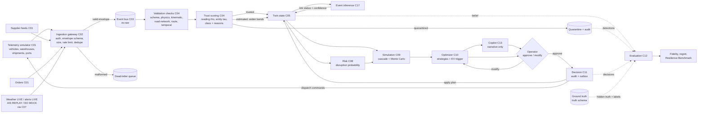

---

## 2. Authoritative end-to-end flow (ADD §7), repeated here as required

**Legend:** EO flood mask `MOCK`; disaster feeds `LIVE` (fallback `REPLAY`); weather `LIVE` (fallback `REPLAY`); AIS `REPLAY`; telemetry synthetic from the ground-truth world.

```mermaid
flowchart TD
    subgraph SRC[Sources]
        SAT[Earth-observation / disaster feeds - LIVE or MOCK]
        WX[Weather forecasts - LIVE]
        TEL[Telemetry simulator - vehicles, warehouses, shipments, ports]
        AIS[AIS vessel data - REPLAY]
    end

    SAT --> ING
    WX --> ING
    TEL --> ING
    AIS --> ING

    ING[Stream Ingestion<br/>Gateway + event bus<br/>rate limit, dead-letter]
    ING --> TRUST[Trust Engine<br/>validation + anomaly detection<br/>trust score + quarantine]
    TRUST -->|trusted or estimated data| TWIN[Digital Twin<br/>graph + state engine + confidence layer]
    TRUST -.->|quarantined| Q[Quarantine queue + audit log]

    TWIN --> PRED[Prediction<br/>disruption probability, node risk, lead-time]
    TWIN --> SIM[Simulation<br/>cascade, compound, Monte Carlo]
    TWIN --> GRAPH[Graph analytics<br/>blast radius, fragility, min-cut]

    PRED --> OPT
    SIM --> OPT
    GRAPH --> OPT

    OPT[Optimization<br/>constraints + objectives + EV trigger]
    OPT --> ROUTE[Routing]
    OPT --> INV[Inventory reallocation]
    OPT --> FLEET[Fleet assignment]

    ROUTE --> COP
    INV --> COP
    FLEET --> COP

    COP[AI Copilot<br/>explains structured optimizer output only]
    COP --> HUMAN[Human decision<br/>approve / modify]
    HUMAN -->|approved action| TWIN
    HUMAN --> AUDIT[Decision audit trail]

    GT[Ground-truth world simulator] -.->|hidden truth| EVAL[Evaluation service<br/>fidelity, regret, benchmark]
    TWIN -.-> EVAL
    TRUST -.-> EVAL
    OPT -.-> EVAL
    GT --> TEL
```

Notes: the Copilot sees only structured optimizer output and trust evidence. The quarantine path never writes to twin state. Truth and labels reach only the evaluation service. Routing and inventory are the MUST optimizer outputs, and fleet is SHOULD/COULD.

---

## 3. Diagram #4: Trust pipeline, including quarantine and fallback to last trusted state

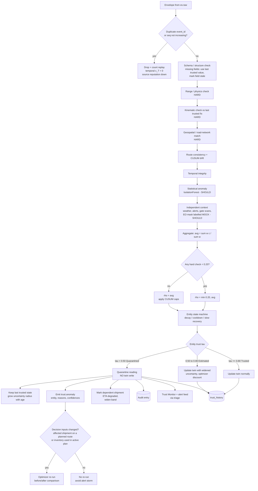

**Incomplete payloads and blackouts (ADD §4.7):** a missing optional field lowers S and the last trusted value is used. A missing required field gives S = 0: the reading is still scored and its fields are not applied. Unparseable messages never reach this pipeline because the gateway sends them to the DLQ. No path in this diagram raises an exception past the worker loop (F-98).

---

## 4. Raw vs trusted comparison flow (F-17, ADD §4.6)

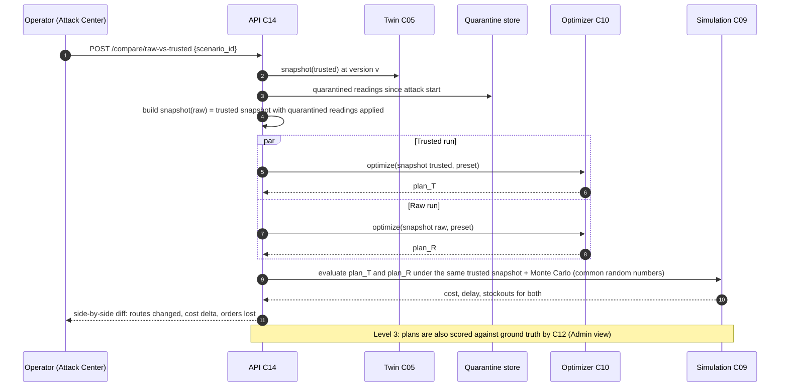

---

## 5. Diagram #5: Degradation mode state machine

F = fresh-source %, C = trusted-coverage %. Each transition requires its condition to hold for 60 sim-seconds.

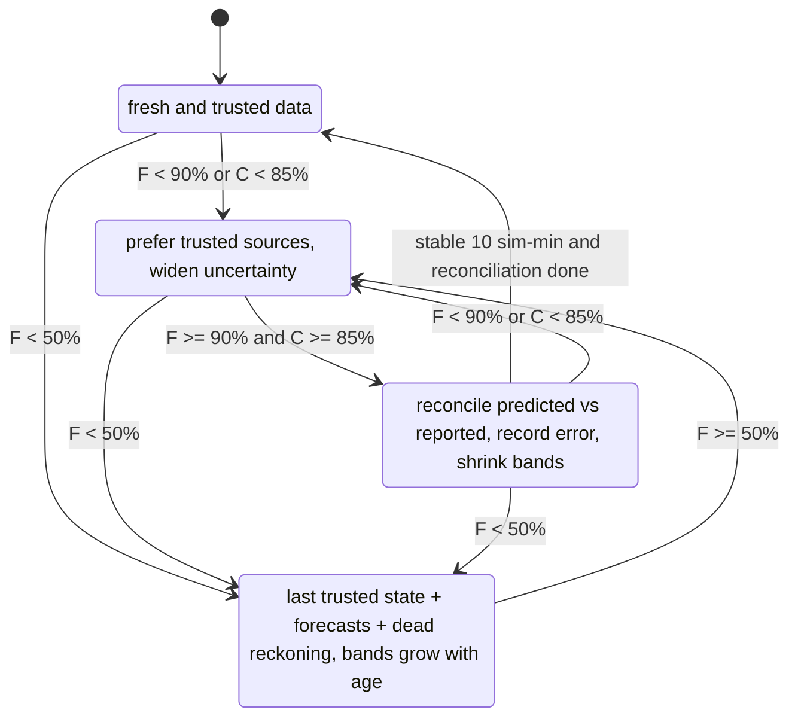

---

## 6. Event-driven decision chain (ADD §5.1)

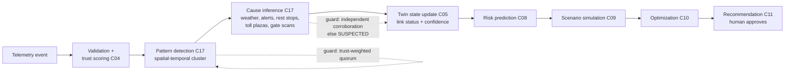

Inference and simulation run automatically. **Execution always needs human approval** in the MVP. The `auto_action_policy` config key exists but defaults to `off`. It is documented only as a future extension (ADD §5.4).

---

## 7. Blockage inference sequence with adversarial guard (ADD §5.2–5.3, F-93, F-94)

### 7.1 Parameters (configurable, defaults)

| Param | Default | Meaning |
|---|---|---|
| N | 4 | Minimum number of trusted vehicles in the cluster |
| R | 2 km | Cluster radius, on the same link |
| T | 15 sim-min | Minimum stop duration |
| v_stop | 5 km/h | Stop speed threshold |
| τ_min | 0.80 | Only readings from Trusted entities count |
| Q | 3.2 | Trust-weighted quorum (Σ τ needed for q = 1) |
| k_ind | 2 | Independent sources (fleets) needed to count as independent confirmation |
| X_max | 0.20 | Contradiction ratio above which the reporters are flagged |
| conf_block | 0.75 | Confidence needed for BLOCKED_INFERRED |
| conf_suspect | 0.40 | Confidence needed for SUSPECTED |

### 7.2 Algorithm

```
cluster  = trusted readings (tau >= 0.80) on link l within R, speed < v_stop, for >= T
if |cluster| < N: return
if cluster overlaps a registered rest stop / toll plaza AND stop duration < 45 min AND no context: return  # benign cause
q  = min(1, Σ tau_i / Q)
I  = min(1, distinct_fleets(cluster) / k_ind)
E  = max(weather_severity_on_corridor >= 0.6 ? 0.8 : 0,
         alert_intersects_link ? 0.9 : 0,
         gate_scan_halt_at_downstream_node ? 0.9 : 0)
X  = Σ tau(trusted vehicles traversing l at > 30 km/h in window) / (that + Σ tau_i)
conf = q * (0.4 + 0.6 * max(I, E)) * (1 - X)
if conf >= 0.75 and (E > 0 or I >= 1):   status = BLOCKED_INFERRED  -> auto simulate + optimize
elif conf >= 0.40:                        status = SUSPECTED         -> ask human to confirm; no routing change
else:                                     status = OPEN (logged)
if X > 0.20: flag cluster reporters (context c_C = 0.2) + raise coordinated_anomaly alert
```

### 7.3 Sequence

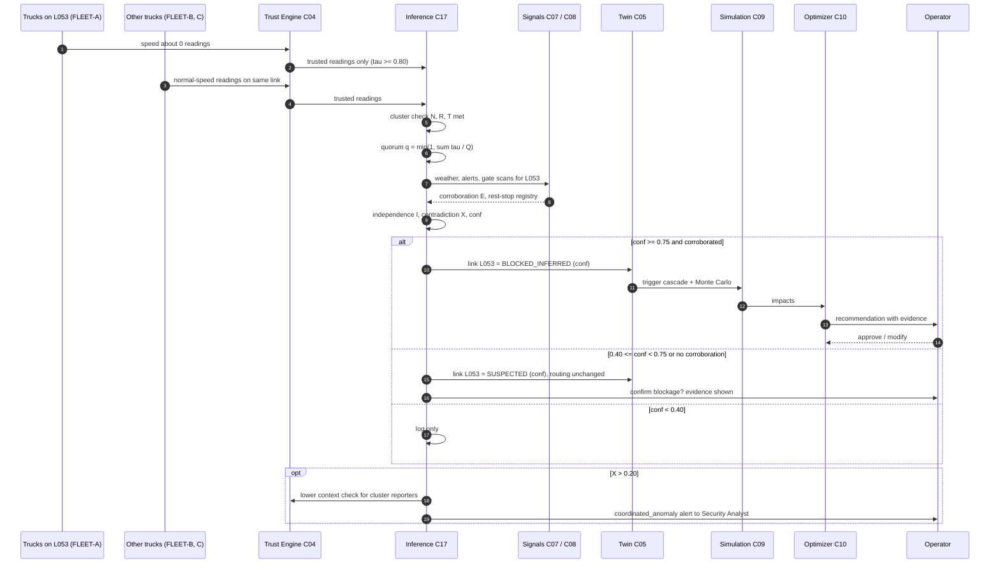

Worked numbers for a coordinated spoof (conf 0.51, SUSPECTED, no auto reroute) and a real blockage (conf 1.0, BLOCKED_INFERRED) are in `02_ARCHITECTURE.md` §5.5 D.

---

## 8. Diagram #6: Cascade propagation sequence (port closure)

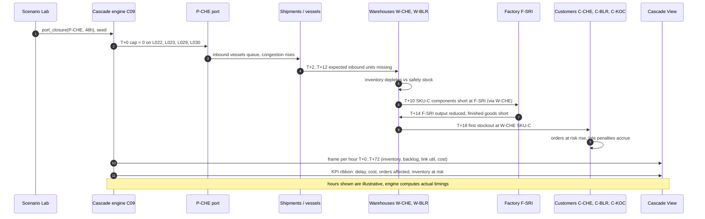

---

## 9. Diagram #7: Proactive weather workflow (BRIEF §5 canonical workflow)

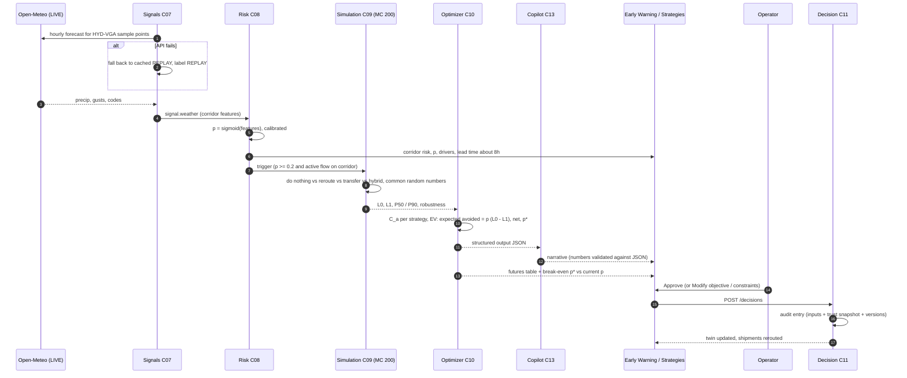

---

## 10. Diagram #8: Evaluation loop

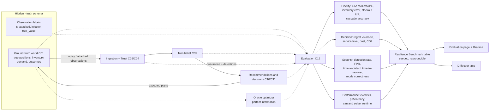

---

## 11. Blackout and recovery flow (UC-06)

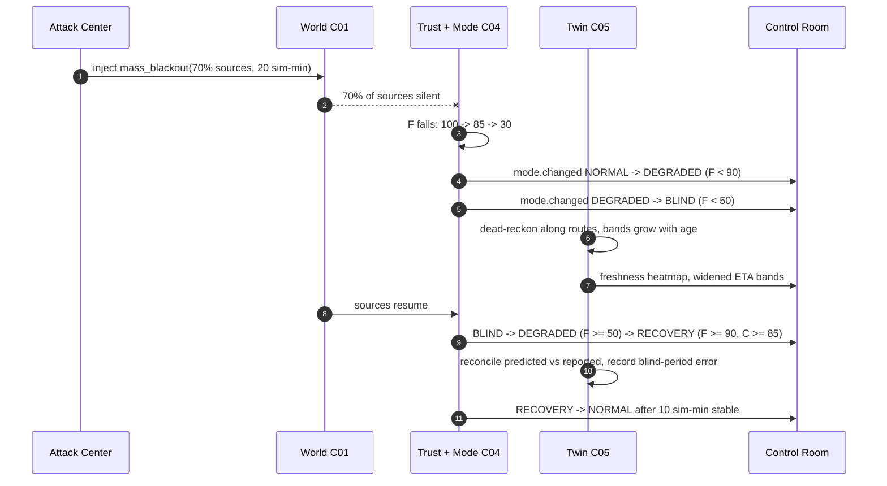
