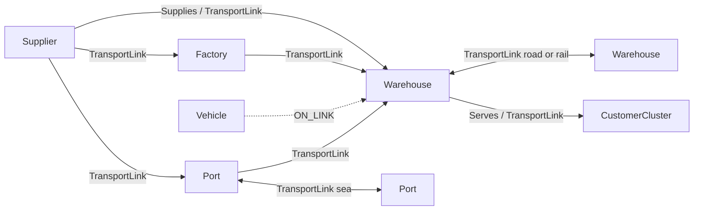
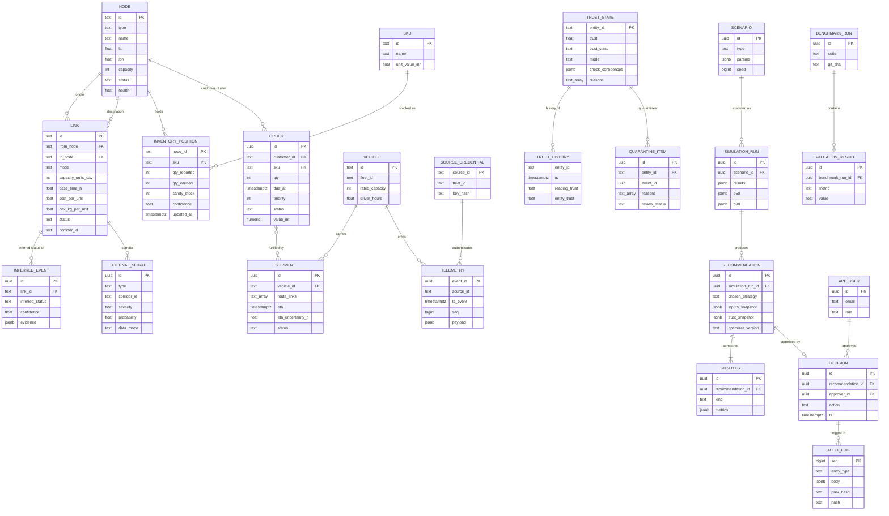

# 04 — Data Model

Contents: (1) conventions · (2) graph schema · (3) ER diagram · (4) relational and time-series DDL · (5) telemetry catalog with JSON Schemas and validation ranges · (6) event envelope and event schemas · (7) seed network (SYNTHETIC) · (8) data-isolation rules.

Traceability: F-01, F-02, F-03, F-64, F-90, F-91, F-93, T-05, T-08, and Level 2 "DB schemas".

---

## 1. Conventions

- Every timestamp is `timestamptz` in UTC. The UI shows IST.
- IDs are human-readable for static entities (`W-HYD`, `L053`, `truck-A-017`) and UUIDv7 for events and records.
- Every row with a value that can be computed stores `computed_by` (module name plus version) where relevant (BRIEF rule 7).
- Every external-signal row stores `data_mode ∈ {LIVE, REPLAY, MOCK}` (BRIEF rule 5).
- Postgres schemas: `twin` (the twin's belief), `sim` (scenarios and runs), `decision` (recommendations, approvals), `audit` (append-only log), `eval` (metrics), `auth` (users, source keys), and **`truth`** (hidden ground truth; see §8).

---

## 2. Graph schema

In memory the graph is a NetworkX `MultiDiGraph` (parallel edges are needed: HYD→VGA has NH65, a Khammam alternative, and rail). It is persisted in `twin.node` and `twin.link`.

### 2.1 Node labels

| Label | Key properties | Notes |
|---|---|---|
| `Supplier` | id, name, lat, lon, capacity (units/day), primary_sku, status, health, reliability | Produces SKUs. |
| `Port` | id, name, lat, lon, capacity (units/day), status (open/restricted/closed), congestion (0–1) | Sea ↔ land transfer point. |
| `Factory` (optional) | id, name, lat, lon, capacity, bill_of_materials | Converts inbound SKU-C/D into shipped goods. At L2 it is modelled as pass-through with a delay. |
| `Warehouse` | id, name, lat, lon, capacity (storage units), dock_rate, power_status, status, health | Holds `InventoryPosition` records. |
| `CustomerCluster` | id, name, lat, lon, demand profile per SKU | Where demand comes from. |
| `Vehicle` (dynamic) | id, fleet_id, type, rated_capacity, current_link, trusted_position, trust | Not a topology node. It is attached to a link through `ON_LINK`. |

### 2.2 Edge types

| Edge | From → To | Properties |
|---|---|---|
| `TransportLink` | any fixed node → any fixed node | id, mode (road/rail/sea), dist_km, capacity_units_day, base_time_h, cost_per_unit, co2_kg_per_unit, status (open/degraded/blocked/blocked_inferred/suspected), corridor_id, geometry (LineString) |
| `Supplies` | Supplier → Warehouse/Factory | sku, contracted_units_day, lead_time_h (derived from links) |
| `Serves` | Warehouse → CustomerCluster | sku, share (primary or secondary), service_level_target |
| `ON_LINK` (dynamic) | Vehicle → TransportLink | progress (0–1), entered_at |



---

## 3. ER diagram



---

## 4. DDL (PostgreSQL 16 + PostGIS + TimescaleDB)

This is the Level 2 target. Alembic migrations will be generated from it.

```sql
CREATE EXTENSION IF NOT EXISTS postgis;
CREATE EXTENSION IF NOT EXISTS timescaledb;
CREATE SCHEMA twin; CREATE SCHEMA sim; CREATE SCHEMA decision;
CREATE SCHEMA audit; CREATE SCHEMA eval; CREATE SCHEMA auth; CREATE SCHEMA truth;

-- ---------- Enumerations ----------
CREATE TYPE twin.node_type    AS ENUM ('Supplier','Port','Factory','Warehouse','CustomerCluster');
CREATE TYPE twin.mode_t       AS ENUM ('road','rail','sea');
CREATE TYPE twin.link_status  AS ENUM ('open','degraded','suspected','blocked_inferred','blocked');
CREATE TYPE twin.trust_class  AS ENUM ('trusted','estimated','quarantined');
CREATE TYPE twin.net_mode     AS ENUM ('NORMAL','DEGRADED','BLIND','RECOVERY');
CREATE TYPE twin.data_mode    AS ENUM ('LIVE','REPLAY','MOCK');
CREATE TYPE auth.role_t       AS ENUM ('viewer','operator','admin');

-- ---------- Topology ----------
CREATE TABLE twin.node (
  id          text PRIMARY KEY,
  type        twin.node_type NOT NULL,
  name        text NOT NULL,
  geom        geography(Point,4326) NOT NULL,
  capacity    integer NOT NULL CHECK (capacity >= 0),
  status      text NOT NULL DEFAULT 'open',            -- open | restricted | closed | failed
  health      real NOT NULL DEFAULT 1.0 CHECK (health BETWEEN 0 AND 1),
  attrs       jsonb NOT NULL DEFAULT '{}'::jsonb,      -- primary_sku, dock_rate, reliability...
  updated_at  timestamptz NOT NULL DEFAULT now()
);
CREATE INDEX ON twin.node USING gist (geom);

CREATE TABLE twin.link (
  id                 text PRIMARY KEY,
  from_node          text NOT NULL REFERENCES twin.node(id),
  to_node            text NOT NULL REFERENCES twin.node(id),
  mode               twin.mode_t NOT NULL,
  dist_km            real NOT NULL CHECK (dist_km > 0),
  capacity_units_day integer NOT NULL CHECK (capacity_units_day > 0),
  base_time_h        real NOT NULL CHECK (base_time_h > 0),
  cost_per_unit      numeric(10,2) NOT NULL,
  co2_kg_per_unit    real NOT NULL,
  status             twin.link_status NOT NULL DEFAULT 'open',
  status_confidence  real NOT NULL DEFAULT 1.0,
  corridor_id        text NOT NULL,
  geom               geography(LineString,4326),
  updated_at         timestamptz NOT NULL DEFAULT now()
);
CREATE INDEX ON twin.link (from_node); CREATE INDEX ON twin.link (to_node);
CREATE INDEX ON twin.link (corridor_id); CREATE INDEX ON twin.link USING gist (geom);

CREATE TABLE twin.sku (id text PRIMARY KEY, name text NOT NULL, unit_value_inr numeric(12,2) NOT NULL);

-- ---------- Live state ----------
CREATE TABLE twin.inventory_position (
  node_id       text REFERENCES twin.node(id),
  sku           text REFERENCES twin.sku(id),
  qty_reported  integer NOT NULL CHECK (qty_reported >= 0),
  qty_verified  integer NOT NULL CHECK (qty_verified >= 0),   -- reconciled vs recorded flows
  safety_stock  integer NOT NULL CHECK (safety_stock >= 0),
  confidence    real NOT NULL CHECK (confidence BETWEEN 0 AND 1),
  conf_class    text NOT NULL DEFAULT 'verified',             -- verified | estimated | suspicious
  updated_at    timestamptz NOT NULL,
  PRIMARY KEY (node_id, sku)
);

CREATE TABLE twin."order" (
  id           uuid PRIMARY KEY,
  customer_id  text NOT NULL REFERENCES twin.node(id),
  sku          text NOT NULL REFERENCES twin.sku(id),
  qty          integer NOT NULL CHECK (qty > 0),
  due_at       timestamptz NOT NULL,
  priority     smallint NOT NULL CHECK (priority BETWEEN 1 AND 3),   -- 1 = highest
  status       text NOT NULL,        -- open | allocated | in_transit | delivered | late | lost
  value_inr    numeric(12,2) NOT NULL,
  source_node  text REFERENCES twin.node(id),
  created_at   timestamptz NOT NULL DEFAULT now()
);
CREATE INDEX ON twin."order" (status, due_at);

CREATE TABLE twin.vehicle (
  id              text PRIMARY KEY,
  fleet_id        text NOT NULL,
  vtype           text NOT NULL DEFAULT 'truck_20p',
  rated_capacity  integer NOT NULL,
  speed_limit_kmh real NOT NULL DEFAULT 100,
  current_link    text REFERENCES twin.link(id),
  trusted_geom    geography(Point,4326),
  trusted_ts      timestamptz,
  pos_uncert_km   real NOT NULL DEFAULT 0.05,
  load_units      integer NOT NULL DEFAULT 0,
  driver_hours    real NOT NULL DEFAULT 0
);

CREATE TABLE twin.shipment (
  id                 uuid PRIMARY KEY,
  order_ids          uuid[] NOT NULL,
  vehicle_id         text REFERENCES twin.vehicle(id),
  route_links        text[] NOT NULL,
  cargo_type         text NOT NULL,
  priority           smallint NOT NULL,
  eta                timestamptz,
  eta_uncertainty_h  real NOT NULL DEFAULT 0.25,
  eta_degraded       boolean NOT NULL DEFAULT false,
  status             text NOT NULL        -- planned | in_transit | delayed | delivered | rerouted
);

-- ---------- Telemetry and trust (hypertables) ----------
CREATE TABLE twin.telemetry_raw (
  event_id     uuid NOT NULL,
  source_id    text NOT NULL,
  source_type  text NOT NULL,
  event_type   text NOT NULL,
  ts_event     timestamptz NOT NULL,
  ts_ingested  timestamptz NOT NULL,
  seq          bigint,
  payload      jsonb NOT NULL,
  payload_hash bytea NOT NULL,
  sig_valid    boolean,
  PRIMARY KEY (event_id, ts_ingested)
);
SELECT create_hypertable('twin.telemetry_raw','ts_ingested', chunk_time_interval => interval '1 hour');
SELECT add_retention_policy('twin.telemetry_raw', interval '7 days');
CREATE INDEX ON twin.telemetry_raw (source_id, ts_event DESC);

CREATE TABLE twin.trust_state (
  entity_id              text PRIMARY KEY,         -- truck-A-017, feed:S03, wh:W-HYD
  entity_kind            text NOT NULL,            -- vehicle | supplier_feed | warehouse_feed | port_feed
  trust                  real NOT NULL CHECK (trust BETWEEN 0 AND 1),
  trust_class            twin.trust_class NOT NULL,
  check_confidences      jsonb NOT NULL,           -- {"schema":1,"physics":0.0,...}
  reasons                text[] NOT NULL DEFAULT '{}',
  consecutive_good       integer NOT NULL DEFAULT 0,
  last_anomaly_at        timestamptz,
  last_trusted_state_ref uuid,                     -- event_id of last trusted reading
  cusum_route            real NOT NULL DEFAULT 0,
  source_reputation      real NOT NULL DEFAULT 1.0,
  updated_at             timestamptz NOT NULL
);

CREATE TABLE twin.trust_history (
  entity_id      text NOT NULL,
  ts             timestamptz NOT NULL,
  event_id       uuid,
  reading_trust  real NOT NULL,
  entity_trust   real NOT NULL,
  trust_class    twin.trust_class NOT NULL,
  checks         jsonb NOT NULL,
  reasons        text[] NOT NULL DEFAULT '{}'
);
SELECT create_hypertable('twin.trust_history','ts', chunk_time_interval => interval '1 day');
CREATE INDEX ON twin.trust_history (entity_id, ts DESC);

CREATE TABLE twin.quarantine_item (
  id             uuid PRIMARY KEY,
  entity_id      text NOT NULL,
  event_id       uuid NOT NULL,
  raw_payload    jsonb NOT NULL,
  reasons        text[] NOT NULL,
  reading_trust  real NOT NULL,
  created_at     timestamptz NOT NULL DEFAULT now(),
  review_status  text NOT NULL DEFAULT 'open',     -- open | confirmed_attack | false_positive
  reviewed_by    uuid
);

CREATE TABLE twin.dead_letter (
  id           uuid PRIMARY KEY,
  received_at  timestamptz NOT NULL DEFAULT now(),
  source_id    text,
  raw          bytea NOT NULL,                      -- stored verbatim, never parsed again automatically
  error_class  text NOT NULL,                       -- json_decode | envelope_schema | unknown_type | oversize
  error_detail text
);

CREATE TABLE twin.network_mode_history (
  ts         timestamptz NOT NULL,
  mode       twin.net_mode NOT NULL,
  freshness  real NOT NULL,      -- F, % of sources fresh
  coverage   real NOT NULL,      -- C, % of entities trusted
  reason     text
);
SELECT create_hypertable('twin.network_mode_history','ts');

CREATE TABLE twin.external_signal (
  id           uuid PRIMARY KEY,
  type         text NOT NULL,                  -- weather | alert | ais | eo_flood
  corridor_id  text,
  node_id      text,
  ts           timestamptz NOT NULL,
  valid_from   timestamptz, valid_to timestamptz,
  severity     real CHECK (severity BETWEEN 0 AND 1),
  probability  real CHECK (probability BETWEEN 0 AND 1),
  features     jsonb NOT NULL,                 -- e.g. {"precip_6h_mm":88,"gust_kmh":54}
  source       text NOT NULL,                  -- open-meteo | gdacs | ais-sample | eo-mask
  data_mode    twin.data_mode NOT NULL,
  computed_by  text
);
CREATE INDEX ON twin.external_signal (corridor_id, ts DESC);

CREATE TABLE twin.inferred_event (
  id               uuid PRIMARY KEY,
  link_id          text NOT NULL REFERENCES twin.link(id),
  inferred_status  twin.link_status NOT NULL,   -- suspected | blocked_inferred | open
  confidence       real NOT NULL,
  quorum_score     real NOT NULL,
  independent_srcs integer NOT NULL,
  corroboration    real NOT NULL,
  contradiction    real NOT NULL,
  evidence         jsonb NOT NULL,              -- vehicle ids, trusts, weather ids, gate scans
  needs_human      boolean NOT NULL,
  created_at       timestamptz NOT NULL DEFAULT now(),
  resolved_at      timestamptz,
  resolution       text
);

-- ---------- Simulation ----------
CREATE TABLE sim.scenario (
  id       uuid PRIMARY KEY,
  type     text NOT NULL,       -- port_closure | warehouse_failure | supplier_failure | demand_spike | weather | fleet_failure | fuel_shock | compound
  params   jsonb NOT NULL,
  seed     bigint NOT NULL,
  version  integer NOT NULL DEFAULT 1,
  created_by uuid, created_at timestamptz NOT NULL DEFAULT now()
);
CREATE TABLE sim.simulation_run (
  id            uuid PRIMARY KEY,
  scenario_id   uuid NOT NULL REFERENCES sim.scenario(id),
  twin_snapshot_ref text NOT NULL,     -- snapshot id the run started from
  kind          text NOT NULL,         -- cascade | monte_carlo
  n_runs        integer NOT NULL DEFAULT 1,
  results       jsonb NOT NULL,        -- timeline, orders at risk, stockout times
  p50           jsonb, p90 jsonb,
  robustness    real,
  runtime_ms    integer NOT NULL,
  engine_version text NOT NULL,
  created_at    timestamptz NOT NULL DEFAULT now()
);

-- ---------- Decisions and audit ----------
CREATE TABLE decision.recommendation (
  id                 uuid PRIMARY KEY,
  simulation_run_id  uuid REFERENCES sim.simulation_run(id),
  trigger            text NOT NULL,          -- weather | scenario | inference | quarantine_rerun
  objective_preset   text NOT NULL,          -- cheapest | fastest | lowest_carbon | lowest_risk | balanced
  chosen_strategy    text NOT NULL,
  ev                 jsonb NOT NULL,         -- {p, L0, L1, C_a, expected_avoided, net, p_star}
  inputs_snapshot    jsonb NOT NULL,
  trust_snapshot     jsonb NOT NULL,
  optimizer_version  text NOT NULL,
  solver_status      text NOT NULL,          -- optimal | feasible_timeout | heuristic_fallback
  explanation        text,
  explanation_source text,                   -- llm | template
  created_at         timestamptz NOT NULL DEFAULT now()
);
CREATE TABLE decision.strategy (
  id                 uuid PRIMARY KEY,
  recommendation_id  uuid NOT NULL REFERENCES decision.recommendation(id),
  kind               text NOT NULL,          -- do_nothing | reroute | transfer | hybrid
  plan               jsonb NOT NULL,         -- flows, transfers, assignments
  metrics            jsonb NOT NULL,         -- cost, delay_h, stockout_risk, orders_saved, co2, p50, p90, robustness
  constraint_checks  jsonb NOT NULL          -- [{name, ok, detail}]
);
CREATE TABLE decision.decision (
  id                 uuid PRIMARY KEY,
  recommendation_id  uuid NOT NULL REFERENCES decision.recommendation(id),
  approver_id        uuid NOT NULL,
  action             text NOT NULL,          -- approve | modify | reject
  modified_params    jsonb,
  ts                 timestamptz NOT NULL DEFAULT now()
);
CREATE TABLE audit.audit_log (          -- append-only; UPDATE/DELETE revoked from all app roles
  seq         bigserial PRIMARY KEY,
  ts          timestamptz NOT NULL DEFAULT now(),
  entry_type  text NOT NULL,             -- recommendation | decision | quarantine | mode_change | inference | login
  actor       text NOT NULL,
  body        jsonb NOT NULL,
  prev_hash   bytea NOT NULL,
  hash        bytea NOT NULL             -- sha256(prev_hash || canonical_json(body))
);

-- ---------- Evaluation ----------
CREATE TABLE eval.benchmark_run (
  id uuid PRIMARY KEY, suite text NOT NULL, git_sha text NOT NULL,
  seed bigint NOT NULL, started_at timestamptz NOT NULL, finished_at timestamptz
);
CREATE TABLE eval.evaluation_result (
  id uuid PRIMARY KEY,
  benchmark_run_id uuid REFERENCES eval.benchmark_run(id),
  suite text NOT NULL, scenario text, metric text NOT NULL,
  value double precision NOT NULL, unit text, ts timestamptz NOT NULL DEFAULT now()
);

-- ---------- Auth ----------
CREATE TABLE auth.app_user (
  id uuid PRIMARY KEY, email text UNIQUE NOT NULL,
  password_hash text NOT NULL,           -- argon2id
  role auth.role_t NOT NULL, created_at timestamptz NOT NULL DEFAULT now()
);
CREATE TABLE auth.source_credential (
  source_id text PRIMARY KEY, fleet_id text, key_hash text NOT NULL,
  hmac_secret_ref text,                  -- reference to secret store, never the secret
  rate_limit_per_min integer NOT NULL DEFAULT 6000, active boolean NOT NULL DEFAULT true
);

-- ---------- Hidden ground truth (see §8) ----------
CREATE TABLE truth.vehicle_state (vehicle_id text, ts timestamptz, geom geography(Point,4326),
  speed_kmh real, link_id text, progress real, PRIMARY KEY (vehicle_id, ts));
CREATE TABLE truth.inventory (node_id text, sku text, ts timestamptz, qty integer, PRIMARY KEY (node_id, sku, ts));
CREATE TABLE truth.link_state (link_id text, ts timestamptz, status text, cause text, PRIMARY KEY (link_id, ts));
CREATE TABLE truth.observation_label (event_id uuid PRIMARY KEY, run_id uuid NOT NULL,
  is_attacked boolean NOT NULL, injector text, true_value jsonb NOT NULL, emitted_at timestamptz NOT NULL);
CREATE TABLE truth.outcome (run_id uuid, order_id uuid, delivered_at timestamptz, stockout boolean,
  cost_inr numeric, PRIMARY KEY (run_id, order_id));
SELECT create_hypertable('truth.vehicle_state','ts');

-- ---------- Roles (least privilege) ----------
-- twin_rw : twin, sim, decision (rw), audit (INSERT only), NO access to truth
-- truth_rw: truth only (world-sim container)
-- eval_ro : SELECT on truth, twin, sim, decision; rw on eval
```

**Query-optimisation notes (L4):** the hot reads are (a) current state snapshot, served from the Redis cache and rebuilt on `twin.state_changed` diffs; (b) trust history per entity, served by `(entity_id, ts DESC)` indexes on the hypertable; (c) the latest signals per corridor, served by `(corridor_id, ts DESC)`. Timescale compression runs on `telemetry_raw` chunks older than 6 h.

---

## 5. Telemetry catalog and signal JSON Schemas (ADD §2, F-90)

All telemetry is **synthetic** (generated by the world simulator, C01) unless it is marked otherwise. "Validation" is what the Trust Engine checks: hard ranges are enforced in the schema, and soft plausibility rules are listed under `x-plausibility`. That keyword is ignored by standard validators and read by the Trust Engine.

### 5.1 Catalog summary

| Signal | event_type | Unit | Rate | Hard range | Soft plausibility (trust checks) | Pri |
|---|---|---|---|---|---|---|
| GPS position | telemetry.vehicle | lat, lon WGS84 | 1 per 5–30 s | lat 6.5–37.5, lon 68.0–97.5 (India bbox) | ≤ 2 km from road geometry; reachable from last trusted fix within Δt | M |
| Speed | telemetry.vehicle | km/h | with GPS | 0–120 (hard cap) | ≤ 100 for trucks; consistent with position delta | M |
| Heading | telemetry.vehicle | deg | with GPS | 0 ≤ h < 360 | within 45° of movement vector when speed > 10 | S |
| Load | telemetry.vehicle | units | on change | 0 ≤ load ≤ rated_capacity | changes only at nodes | M |
| Fuel level | telemetry.vehicle | % | 1/min | 0–100 | monotonic decrease except refuel; drop consistent with distance | S |
| Engine temp | telemetry.vehicle | °C | 1/min | 60–115 | — | C |
| Brake status | telemetry.vehicle | enum | on change | ok, warning | — | C |
| Cargo temp | telemetry.vehicle | °C | 1/min | −30 to 40 | within the cargo band (pharma 2–8) | C |
| Driver hours | telemetry.vehicle | h | on change | 0–14 | ≤ 11 legal driving limit (warn) | S |
| Inventory level | telemetry.warehouse | units | on change or 1/min | 0 ≤ qty ≤ capacity | Δqty ≈ recorded inbound − outbound ± 2% | M |
| Storage capacity | telemetry.warehouse | units | rare | > 0 | equals registry value | M |
| Loading rate | telemetry.warehouse | units/h | 1/min | 0 ≤ r ≤ dock_rate | — | S |
| Temp / humidity | telemetry.warehouse | °C, % | 1/min | −10–60, 0–100 | — | C |
| Power status | telemetry.warehouse | enum | on change | ok, backup, down | — | S |
| Shipment status | telemetry.shipment | object | on state change | route_links ⊂ link registry | location derived from the assigned vehicle | M |
| Port congestion | telemetry.port | index 0–1 | 1 per 5 min | 0–1 | Δ ≤ 0.3 per 5 min | M |
| Vessel arrival | signal.ais | event | REPLAY | valid MMSI | — | S |
| Container volume | telemetry.port | TEU/h | hourly | 0–20,000 | ≤ loading capacity | S |
| Loading capacity | telemetry.port | TEU/h | rare | > 0 | — | S |
| Port op status | telemetry.port | enum | on change | open, restricted, closed | — | M |
| Gate scan | telemetry.port_gate_scan | event | per truck | valid vehicle_id | vehicle is near the port geofence | S |
| Supplier feed | feed.supplier_inventory | units, h | 1 per 15 min | available ≥ 0; lead_time 0–720 h | consistent with the supplier's capacity | M |
| Weather | signal.weather | mm, km/h, code | 1 per 30 min | precip 0–500 mm/h; gust 0–300 km/h | — | M (`LIVE`) |
| Disaster alert | signal.alert | object | 1 per 15 min | severity ∈ green/orange/red | — | S (`LIVE`) |
| EO flood mask | signal.eo_flood | GeoJSON | static | valid polygons | — | C (`MOCK`) |

### 5.2 Signal schemas

Each schema below is a `$defs` entry in `schemas/telemetry.schema.json` (created at Level 2). Payload schemas compose these definitions.

```json
{
  "$schema": "https://json-schema.org/draft/2020-12/schema",
  "$id": "https://pnt1.local/schemas/telemetry.schema.json",
  "$defs": {
    "gps": {
      "type": "object",
      "required": ["lat", "lon"],
      "properties": {
        "lat": { "type": "number", "minimum": 6.5, "maximum": 37.5 },
        "lon": { "type": "number", "minimum": 68.0, "maximum": 97.5 },
        "hdop": { "type": "number", "minimum": 0, "maximum": 50 }
      },
      "x-plausibility": ["road_distance_km <= 2.0", "reachable_from_last_trusted(dt)", "not_in_water_mask"]
    },
    "speed_kmh": { "type": "number", "minimum": 0, "maximum": 120,
      "x-plausibility": ["<= vehicle.speed_limit_kmh (100)", "|speed - implied_speed| <= 25"] },
    "heading_deg": { "type": "number", "minimum": 0, "exclusiveMaximum": 360,
      "x-plausibility": ["angle_diff(heading, movement_bearing) <= 45 when speed > 10"] },
    "load_units": { "type": "integer", "minimum": 0,
      "x-plausibility": ["<= vehicle.rated_capacity", "changes only within 1 km of a node"] },
    "fuel_pct": { "type": "number", "minimum": 0, "maximum": 100,
      "x-plausibility": ["non-increasing unless refuel event", "drop_pct ≈ km * 0.12 ± 50%"] },
    "engine_temp_c": { "type": "number", "minimum": 60, "maximum": 115 },
    "brake_status": { "enum": ["ok", "warning"] },
    "cargo_temp_c": { "type": "number", "minimum": -30, "maximum": 40,
      "x-plausibility": ["within cargo band, e.g. pharma 2..8"] },
    "driver_hours": { "type": "number", "minimum": 0, "maximum": 14,
      "x-plausibility": ["<= 11 (legal driving limit) else warning"] },

    "inventory_level": {
      "type": "object",
      "required": ["sku", "qty"],
      "properties": {
        "sku": { "type": "string", "pattern": "^SKU-[A-E]$" },
        "qty": { "type": "integer", "minimum": 0 }
      },
      "x-plausibility": ["qty <= node.capacity", "|Δqty - (inbound - outbound)| <= max(5, 0.02*qty)"]
    },
    "storage_capacity": { "type": "integer", "exclusiveMinimum": 0 },
    "dock_rate_uph": { "type": "number", "minimum": 0, "x-plausibility": ["<= node.dock_rate"] },
    "wh_env": { "type": "object", "properties": {
        "temp_c": { "type": "number", "minimum": -10, "maximum": 60 },
        "humidity_pct": { "type": "number", "minimum": 0, "maximum": 100 } } },
    "power_status": { "enum": ["ok", "backup", "down"] },

    "shipment_status": {
      "type": "object",
      "required": ["shipment_id", "vehicle_id", "route_links", "cargo_type", "priority", "status"],
      "properties": {
        "shipment_id": { "type": "string", "format": "uuid" },
        "vehicle_id": { "type": "string" },
        "route_links": { "type": "array", "items": { "type": "string", "pattern": "^L[0-9]{3}$" }, "minItems": 1 },
        "cargo_type": { "enum": ["ambient", "cold_chain", "hazmat", "high_value"] },
        "priority": { "type": "integer", "minimum": 1, "maximum": 3 },
        "status": { "enum": ["planned", "in_transit", "delayed", "delivered", "rerouted"] },
        "eta": { "type": "string", "format": "date-time" },
        "eta_uncertainty_h": { "type": "number", "minimum": 0, "maximum": 72 }
      }
    },

    "port_congestion": { "type": "number", "minimum": 0, "maximum": 1,
      "x-plausibility": ["|Δ| <= 0.3 per 5 min"] },
    "container_volume_teu_h": { "type": "number", "minimum": 0, "maximum": 20000 },
    "loading_capacity_teu_h": { "type": "number", "exclusiveMinimum": 0 },
    "port_status": { "enum": ["open", "restricted", "closed"] },
    "gate_scan": { "type": "object", "required": ["vehicle_id", "gate", "direction"],
      "properties": { "vehicle_id": { "type": "string" }, "gate": { "type": "string" },
        "direction": { "enum": ["in", "out"] } },
      "x-plausibility": ["vehicle trusted position within 5 km of port geofence"] },

    "supplier_inventory": {
      "type": "object",
      "required": ["supplier_id", "sku", "available_units", "lead_time_h"],
      "properties": {
        "supplier_id": { "type": "string", "pattern": "^S[0-9]{2}$" },
        "sku": { "type": "string", "pattern": "^SKU-[A-E]$" },
        "available_units": { "type": "integer", "minimum": 0 },
        "lead_time_h": { "type": "number", "minimum": 0, "maximum": 720 },
        "reported_eta": { "type": "string", "format": "date-time" }
      },
      "x-plausibility": ["available_units <= 14 * supplier.capacity", "|Δavailable| consistent with dispatches"]
    },

    "weather_corridor": {
      "type": "object",
      "required": ["corridor_id", "valid_from", "valid_to", "precip_mm_h", "data_mode"],
      "properties": {
        "corridor_id": { "type": "string" },
        "sample_point": { "$ref": "#/$defs/gps" },
        "valid_from": { "type": "string", "format": "date-time" },
        "valid_to": { "type": "string", "format": "date-time" },
        "precip_mm_h": { "type": "number", "minimum": 0, "maximum": 500 },
        "precip_6h_mm": { "type": "number", "minimum": 0, "maximum": 1500 },
        "gust_kmh": { "type": "number", "minimum": 0, "maximum": 300 },
        "weather_code": { "type": "integer", "minimum": 0, "maximum": 99 },
        "data_mode": { "enum": ["LIVE", "REPLAY", "MOCK"] }
      }
    },
    "alert": {
      "type": "object",
      "required": ["alert_id", "hazard", "level", "geometry", "data_mode"],
      "properties": {
        "alert_id": { "type": "string" },
        "hazard": { "enum": ["flood", "cyclone", "fire", "earthquake", "other"] },
        "level": { "enum": ["green", "orange", "red"] },
        "geometry": { "type": "object" },
        "data_mode": { "enum": ["LIVE", "REPLAY", "MOCK"] }
      }
    },
    "ais_position": {
      "type": "object",
      "required": ["mmsi", "lat", "lon", "sog_kn", "data_mode"],
      "properties": {
        "mmsi": { "type": "string", "pattern": "^[0-9]{9}$" },
        "lat": { "type": "number", "minimum": -90, "maximum": 90 },
        "lon": { "type": "number", "minimum": -180, "maximum": 180 },
        "sog_kn": { "type": "number", "minimum": 0, "maximum": 40 },
        "dest_port": { "type": "string" },
        "eta": { "type": "string", "format": "date-time" },
        "data_mode": { "const": "REPLAY" }
      }
    },
    "eo_flood": {
      "type": "object",
      "required": ["mask_id", "geometry", "data_mode"],
      "properties": { "mask_id": { "type": "string" }, "geometry": { "type": "object" },
        "data_mode": { "const": "MOCK" } }
    }
  }
}
```

### 5.3 Composite payloads by event type

| event_type | payload schema |
|---|---|
| `telemetry.vehicle` | `{ gps (req), speed_kmh (req), heading_deg, load_units, fuel_pct, engine_temp_c, brake_status, cargo_temp_c, driver_hours, shipment_id }` |
| `telemetry.warehouse` | `{ node_id (req), levels: [inventory_level] , storage_capacity, dock_rate_uph, wh_env, power_status }` |
| `telemetry.shipment` | `shipment_status` |
| `telemetry.port` | `{ node_id (req), port_congestion, container_volume_teu_h, loading_capacity_teu_h, port_status }` |
| `telemetry.port_gate_scan` | `gate_scan` + `node_id` |
| `feed.supplier_inventory` | `supplier_inventory` |
| `signal.weather` | `weather_corridor` |
| `signal.alert` | `alert` |
| `signal.ais` | `ais_position` |
| `signal.eo_flood` | `eo_flood` |
| `order.created` / `order.updated` | `{ order_id, customer_id, sku, qty, due_at, priority, status, value_inr }` |

**Incomplete payloads (ADD §4.7):** only the fields marked `(req)` are required by the envelope-level validator. A missing optional field lowers the *Schema* check confidence by 0.1 per missing field (floor 0.3). The field is marked stale, and its last trusted value is used. A missing *required* field sets Schema = 0. The reading is still processed, never thrown, and has no effect on twin state.

---

## 6. Event envelope and domain events

### 6.1 Envelope (ADD §3.2), used on every stream

```json
{
  "$schema": "https://json-schema.org/draft/2020-12/schema",
  "$id": "https://pnt1.local/schemas/envelope.schema.json",
  "type": "object",
  "required": ["event_id", "event_type", "source_id", "source_type", "ts_event", "payload"],
  "properties": {
    "event_id":    { "type": "string", "format": "uuid" },
    "event_type":  { "type": "string", "pattern": "^(telemetry|feed|order|signal|twin|trust|mode|inference|scenario|recommendation|decision)\\.[a-z_]+$" },
    "source_id":   { "type": "string", "maxLength": 64 },
    "source_type": { "enum": ["vehicle", "warehouse", "shipment", "port", "supplier", "weather", "alert", "ais", "eo", "internal"] },
    "ts_event":    { "type": "string", "format": "date-time" },
    "ts_ingested": { "type": "string", "format": "date-time", "description": "set by the gateway, never trusted from the client" },
    "seq":         { "type": "integer", "minimum": 0 },
    "run_id":      { "type": "string", "description": "simulation run id; present for synthetic sources" },
    "payload":     { "type": "object" },
    "signature":   { "type": "string", "pattern": "^[0-9a-f]{64}$", "description": "optional HMAC-SHA256(secret, canonical(envelope without signature)) — F-97" }
  },
  "additionalProperties": false,
  "maxProperties": 10
}
```

The gateway enforces a maximum message size of 16 KB and a maximum batch of 500 envelopes. Anything that is not valid JSON, fails the envelope schema, or has an unknown `event_type` goes to `twin.dead_letter` and is counted. **Ground-truth labels never appear in the envelope** (T-08).

### 6.2 Internal / domain events (published on stream `ev.domain`)

```json
{
  "$id": "https://pnt1.local/schemas/domain.schema.json",
  "$defs": {
    "twin.state_changed": { "type": "object", "required": ["entity_id", "entity_kind", "diff", "snapshot_version"],
      "properties": { "entity_id": {"type":"string"}, "entity_kind": {"type":"string"},
        "diff": {"type":"object"}, "snapshot_version": {"type":"integer"} } },
    "trust.anomaly": { "type": "object", "required": ["entity_id", "reading_trust", "entity_trust", "trust_class", "reasons", "checks", "action"],
      "properties": { "entity_id": {"type":"string"}, "event_id": {"type":"string"},
        "reading_trust": {"type":"number","minimum":0,"maximum":1},
        "entity_trust": {"type":"number","minimum":0,"maximum":1},
        "trust_class": {"enum":["trusted","estimated","quarantined"]},
        "reasons": {"type":"array","items":{"type":"string"}},
        "checks": {"type":"object","additionalProperties":{"type":"number"}},
        "action": {"enum":["none","widen_uncertainty","quarantine","restore_last_trusted"]},
        "decision_inputs_changed": {"type":"boolean"} } },
    "mode.changed": { "type": "object", "required": ["from", "to", "freshness", "coverage"],
      "properties": { "from": {"enum":["NORMAL","DEGRADED","BLIND","RECOVERY"]},
        "to": {"enum":["NORMAL","DEGRADED","BLIND","RECOVERY"]},
        "freshness": {"type":"number"}, "coverage": {"type":"number"}, "reason": {"type":"string"} } },
    "inference.link_status": { "type": "object", "required": ["link_id", "inferred_status", "confidence", "evidence", "needs_human"],
      "properties": { "link_id": {"type":"string"},
        "inferred_status": {"enum":["open","suspected","blocked_inferred"]},
        "confidence": {"type":"number","minimum":0,"maximum":1},
        "quorum_score": {"type":"number"}, "independent_sources": {"type":"integer"},
        "corroboration": {"type":"number"}, "contradiction": {"type":"number"},
        "evidence": {"type":"object"}, "needs_human": {"type":"boolean"} } },
    "scenario.run": { "type": "object", "required": ["scenario_id", "simulation_run_id", "kind", "status"],
      "properties": { "scenario_id": {"type":"string"}, "simulation_run_id": {"type":"string"},
        "kind": {"enum":["cascade","monte_carlo"]}, "status": {"enum":["queued","running","done","failed"]} } },
    "recommendation.created": { "type": "object", "required": ["recommendation_id", "trigger", "chosen_strategy", "ev"],
      "properties": { "recommendation_id": {"type":"string"}, "trigger": {"type":"string"},
        "chosen_strategy": {"type":"string"},
        "ev": {"type":"object","required":["p","L0","L1","C_a","expected_avoided","net","p_star"]} } },
    "decision.approved": { "type": "object", "required": ["decision_id", "recommendation_id", "approver_id", "action"],
      "properties": { "decision_id": {"type":"string"}, "recommendation_id": {"type":"string"},
        "approver_id": {"type":"string"}, "action": {"enum":["approve","modify","reject"]},
        "modified_params": {"type":"object"} } }
  }
}
```

### 6.3 Streams (Redis Streams, E-01)

| Stream | Producer → Consumer group | Key content | Retention |
|---|---|---|---|
| `ev.raw` | gateway → `trust` (N ingest-workers) | every accepted envelope | MAXLEN ~ 1 M; durable copy in `telemetry_raw` |
| `ev.dlq` | gateway, trust → ops dashboard | rejected messages (ref to `dead_letter`) | 100 k |
| `ev.domain` | trust, twin, inference, sim, decision → api (WS fan-out), eval, audit | §6.2 events | 200 k |
| `ev.signal` | signals-worker → risk, twin | weather, alert, AIS | 50 k |
| `truth.labels` | world-sim → **eval only** | `observation_label` rows | written to `truth` schema, stream is not readable by twin_rw |

---

## 7. Seed network (SYNTHETIC)

> **SYNTHETIC.** The locations are approximate city or industrial areas used for realism only. Distances = haversine × mode route factor (ASSUMPTIONS B-03). No real operator data is used. The machine-readable version is in [`seed/seed_network.yaml`](seed/seed_network.yaml).

**Composition:** 8 Suppliers, 5 Ports, 2 Factories, 10 Warehouses, 15 Customer Clusters = **40 nodes**, and **92 directed links** (road 79, rail 7, sea 6). About 120 vehicles in 3 fleets are generated at run start.

**Structural features built in for the presentation:**
- **W-VGA** is the only warehouse serving **C-VTZ**, and the primary one for C-VGA. The fragility audit should flag it as an articulation point for that customer cluster.
- **HYD–VGA** has three parallel options: NH65 road (L053/54, 7.7 h, high capacity), a Khammam road alternative (L055/56, 8.5 h, low capacity) and rail (L071/72, 12.9 h). This is the canonical weather-rerouting corridor (BRIEF §5).
- The east coast sea lane (P-CHE ↔ P-VTZ ↔ P-KOL) gives a slow, low-carbon fallback.

### 7.1 Nodes

| ID | Type | Name | Lat | Lon | Capacity | Primary SKU |
|---|---|---|---|---|---|---|
| S01 | Supplier | Ludhiana auto-parts supplier | 30.9 | 75.85 | 1200 | SKU-D |
| S02 | Supplier | Ahmedabad pharma supplier | 23.02 | 72.57 | 900 | SKU-B |
| S03 | Supplier | Chakan (Pune) auto-parts supplier | 18.76 | 73.86 | 1400 | SKU-D |
| S04 | Supplier | Sriperumbudur electronics supplier | 12.96 | 79.95 | 1100 | SKU-C |
| S05 | Supplier | Hosur electronics supplier | 12.74 | 77.83 | 1000 | SKU-C |
| S06 | Supplier | Indore packaged-food supplier | 22.72 | 75.86 | 1600 | SKU-A |
| S07 | Supplier | Visakhapatnam pharma supplier | 17.69 | 83.22 | 800 | SKU-B |
| S08 | Supplier | Kolkata consumer-goods supplier | 22.57 | 88.36 | 1300 | SKU-E |
| P-MUN | Port | Mundra-type port (Gujarat) | 22.74 | 69.7 | 6000 | — |
| P-JNP | Port | Nhava Sheva-type port (Mumbai) | 18.95 | 72.95 | 7000 | — |
| P-CHE | Port | Chennai-type port | 13.1 | 80.3 | 5000 | — |
| P-VTZ | Port | Visakhapatnam-type port | 17.69 | 83.28 | 3500 | — |
| P-KOL | Port | Kolkata/Haldia-type port | 22.03 | 88.06 | 3000 | — |
| F-SAN | Factory | Sanand assembly plant | 22.99 | 72.38 | 1500 | — |
| F-SRI | Factory | Sriperumbudur assembly plant | 12.97 | 79.94 | 1500 | — |
| W-DEL | Warehouse | Delhi NCR hub (Farukhnagar-type) | 28.45 | 76.83 | 60000 | — |
| W-AMD | Warehouse | Ahmedabad hub | 23.03 | 72.58 | 35000 | — |
| W-BOM | Warehouse | Mumbai hub (Bhiwandi-type) | 19.3 | 73.06 | 55000 | — |
| W-PNQ | Warehouse | Pune hub | 18.52 | 73.86 | 30000 | — |
| W-NAG | Warehouse | Nagpur hub | 21.15 | 79.09 | 40000 | — |
| W-HYD | Warehouse | Hyderabad hub (Shamshabad-type) | 17.24 | 78.43 | 50000 | — |
| W-VGA | Warehouse | Vijayawada hub | 16.51 | 80.65 | 25000 | — |
| W-BLR | Warehouse | Bengaluru hub (Hoskote-type) | 13.07 | 77.8 | 50000 | — |
| W-CHE | Warehouse | Chennai hub | 13.03 | 80.02 | 40000 | — |
| W-KOL | Warehouse | Kolkata hub (Dankuni-type) | 22.68 | 88.29 | 35000 | — |
| C-DEL | CustomerCluster | Delhi NCR demand cluster | 28.61 | 77.21 | — | — |
| C-JAI | CustomerCluster | Jaipur demand cluster | 26.91 | 75.79 | — | — |
| C-LKO | CustomerCluster | Lucknow demand cluster | 26.85 | 80.95 | — | — |
| C-MUM | CustomerCluster | Mumbai demand cluster | 19.08 | 72.88 | — | — |
| C-PNQ | CustomerCluster | Pune demand cluster | 18.52 | 73.86 | — | — |
| C-AMD | CustomerCluster | Ahmedabad demand cluster | 23.02 | 72.57 | — | — |
| C-NAG | CustomerCluster | Nagpur demand cluster | 21.15 | 79.09 | — | — |
| C-HYD | CustomerCluster | Hyderabad demand cluster | 17.39 | 78.49 | — | — |
| C-VGA | CustomerCluster | Vijayawada demand cluster | 16.51 | 80.65 | — | — |
| C-VTZ | CustomerCluster | Visakhapatnam demand cluster | 17.69 | 83.22 | — | — |
| C-BHU | CustomerCluster | Bhubaneswar demand cluster | 20.3 | 85.82 | — | — |
| C-BLR | CustomerCluster | Bengaluru demand cluster | 12.97 | 77.59 | — | — |
| C-CHE | CustomerCluster | Chennai demand cluster | 13.08 | 80.27 | — | — |
| C-KOC | CustomerCluster | Kochi demand cluster | 9.93 | 76.27 | — | — |
| C-KOL | CustomerCluster | Kolkata demand cluster | 22.57 | 88.36 | — | — |

### 7.2 Links

| Link | From | To | Mode | Dist km | Base time h | Capacity units/day | Cost ₹/unit | CO₂ kg/unit | Corridor |
|---|---|---|---|---|---|---|---|---|---|
| L001 | S01 | W-DEL | road | 375 | 8.8 | 1800 | 844 | 11.6 | S01-W-DEL |
| L002 | S02 | W-AMD | road | 15 | 0.8 | 1800 | 34 | 0.5 | S02-W-AMD |
| L003 | S02 | W-BOM | road | 542 | 12.5 | 1800 | 1219 | 16.8 | S02-W-BOM |
| L004 | S03 | W-PNQ | road | 35 | 1.3 | 1800 | 78 | 1.1 | S03-W-PNQ |
| L005 | S03 | W-BOM | road | 134 | 3.5 | 1800 | 302 | 4.2 | S03-W-BOM |
| L006 | S03 | F-SAN | road | 643 | 14.8 | 900 | 1447 | 19.9 | S03-F-SAN |
| L007 | S04 | F-SRI | road | 15 | 0.8 | 1800 | 34 | 0.5 | S04-F-SRI |
| L008 | S04 | W-CHE | road | 15 | 0.8 | 1800 | 34 | 0.5 | S04-W-CHE |
| L009 | S05 | W-BLR | road | 48 | 1.6 | 1800 | 108 | 1.5 | S05-W-BLR |
| L010 | S05 | F-SRI | road | 299 | 7.1 | 900 | 673 | 9.3 | S05-F-SRI |
| L011 | S06 | W-NAG | road | 489 | 11.4 | 1800 | 1100 | 15.2 | S06-W-NAG |
| L012 | S06 | W-AMD | road | 439 | 10.3 | 1800 | 988 | 13.6 | S06-W-AMD |
| L013 | S06 | W-DEL | road | 838 | 19.1 | 900 | 1885 | 26 | S06-W-DEL |
| L014 | S07 | W-VGA | road | 394 | 9.3 | 1800 | 886 | 12.2 | S07-W-VGA |
| L015 | S07 | P-VTZ | road | 15 | 0.8 | 900 | 34 | 0.5 | S07-P-VTZ |
| L016 | S08 | W-KOL | road | 18 | 0.9 | 1800 | 41 | 0.6 | S08-W-KOL |
| L017 | S08 | P-KOL | road | 88 | 2.5 | 900 | 197 | 2.7 | S08-P-KOL |
| L018 | P-MUN | W-AMD | road | 386 | 9.1 | 1800 | 868 | 12 | P-MUN-W-AMD |
| L019 | P-MUN | W-DEL | rail | 1195 | 38.1 | 2500 | 1434 | 13.1 | WDFC |
| L020 | P-JNP | W-BOM | road | 53 | 1.7 | 3000 | 119 | 1.6 | P-JNP-W-BOM |
| L021 | P-JNP | W-PNQ | road | 139 | 3.6 | 1800 | 313 | 4.3 | P-JNP-W-PNQ |
| L022 | P-CHE | W-CHE | road | 41 | 1.4 | 3000 | 92 | 1.3 | P-CHE-W-CHE |
| L023 | P-CHE | W-BLR | road | 352 | 8.3 | 1800 | 792 | 10.9 | P-CHE-W-BLR |
| L024 | P-VTZ | W-VGA | road | 401 | 9.4 | 1800 | 903 | 12.4 | P-VTZ-W-VGA |
| L025 | P-VTZ | W-HYD | road | 672 | 15.4 | 900 | 1512 | 20.8 | P-VTZ-W-HYD |
| L026 | P-KOL | W-KOL | road | 99 | 2.7 | 1800 | 222 | 3.1 | P-KOL-W-KOL |
| L027 | P-MUN | P-JNP | sea | 729 | 41.2 | 4000 | 437 | 5.8 | WCOAST |
| L028 | P-JNP | P-MUN | sea | 729 | 41.2 | 4000 | 437 | 5.8 | WCOAST |
| L029 | P-CHE | P-VTZ | sea | 813 | 44.5 | 4000 | 488 | 6.5 | ECOAST |
| L030 | P-VTZ | P-CHE | sea | 813 | 44.5 | 4000 | 488 | 6.5 | ECOAST |
| L031 | P-VTZ | P-KOL | sea | 938 | 49.5 | 4000 | 563 | 7.5 | ECOAST |
| L032 | P-KOL | P-VTZ | sea | 938 | 49.5 | 4000 | 563 | 7.5 | ECOAST |
| L033 | F-SAN | W-AMD | road | 27 | 1.1 | 1800 | 61 | 0.8 | F-SAN-W-AMD |
| L034 | F-SAN | W-BOM | road | 541 | 12.5 | 1800 | 1218 | 16.8 | F-SAN-W-BOM |
| L035 | F-SAN | W-DEL | road | 979 | 22.3 | 900 | 2203 | 30.3 | F-SAN-W-DEL |
| L036 | F-SRI | W-CHE | road | 15 | 0.8 | 1800 | 34 | 0.5 | F-SRI-W-CHE |
| L037 | F-SRI | W-BLR | road | 302 | 7.2 | 1800 | 679 | 9.4 | F-SRI-W-BLR |
| L038 | F-SRI | W-HYD | road | 652 | 15 | 900 | 1467 | 20.2 | F-SRI-W-HYD |
| L039 | W-DEL | W-AMD | road | 959 | 21.8 | 1800 | 2158 | 29.7 | NH48N |
| L040 | W-AMD | W-DEL | road | 959 | 21.8 | 1800 | 2158 | 29.7 | NH48N |
| L041 | W-AMD | W-BOM | road | 543 | 12.6 | 3000 | 1222 | 16.8 | NH48W |
| L042 | W-BOM | W-AMD | road | 543 | 12.6 | 3000 | 1222 | 16.8 | NH48W |
| L043 | W-BOM | W-PNQ | road | 157 | 4 | 3000 | 353 | 4.9 | MUMPUN |
| L044 | W-PNQ | W-BOM | road | 157 | 4 | 3000 | 353 | 4.9 | MUMPUN |
| L045 | W-PNQ | W-HYD | road | 655 | 15.1 | 1800 | 1474 | 20.3 | NH65W |
| L046 | W-HYD | W-PNQ | road | 655 | 15.1 | 1800 | 1474 | 20.3 | NH65W |
| L047 | W-BOM | W-NAG | road | 860 | 19.6 | 1800 | 1936 | 26.7 | SAMRUDDHI |
| L048 | W-NAG | W-BOM | road | 860 | 19.6 | 1800 | 1936 | 26.7 | SAMRUDDHI |
| L049 | W-NAG | W-HYD | road | 572 | 13.2 | 1800 | 1288 | 17.7 | NH44C |
| L050 | W-HYD | W-NAG | road | 572 | 13.2 | 1800 | 1288 | 17.7 | NH44C |
| L051 | W-DEL | W-NAG | road | 1096 | 24.9 | 900 | 2466 | 34 | NH44N |
| L052 | W-NAG | W-DEL | road | 1096 | 24.9 | 900 | 2466 | 34 | NH44N |
| L053 | W-HYD | W-VGA | road | 325 | 7.7 | 3000 | 731 | 10.1 | HYD-VGA-NH65 |
| L054 | W-VGA | W-HYD | road | 325 | 7.7 | 3000 | 731 | 10.1 | HYD-VGA-NH65 |
| L055 | W-HYD | W-VGA | road | 362 | 8.5 | 900 | 815 | 11.2 | HYD-VGA-KHAMMAM |
| L056 | W-VGA | W-HYD | road | 362 | 8.5 | 900 | 815 | 11.2 | HYD-VGA-KHAMMAM |
| L057 | W-HYD | W-BLR | road | 609 | 14 | 3000 | 1371 | 18.9 | NH44S |
| L058 | W-BLR | W-HYD | road | 609 | 14 | 3000 | 1371 | 18.9 | NH44S |
| L059 | W-BLR | W-CHE | road | 313 | 7.4 | 3000 | 704 | 9.7 | BLR-CHE |
| L060 | W-CHE | W-BLR | road | 313 | 7.4 | 3000 | 704 | 9.7 | BLR-CHE |
| L061 | W-CHE | W-VGA | road | 511 | 11.8 | 1800 | 1149 | 15.8 | NH16S |
| L062 | W-VGA | W-CHE | road | 511 | 11.8 | 1800 | 1149 | 15.8 | NH16S |
| L063 | W-VGA | W-KOL | road | 1370 | 30.9 | 900 | 3082 | 42.5 | NH16N |
| L064 | W-KOL | W-VGA | road | 1370 | 30.9 | 900 | 3082 | 42.5 | NH16N |
| L065 | W-NAG | W-KOL | road | 1253 | 28.3 | 900 | 2820 | 38.8 | NH53 |
| L066 | W-KOL | W-NAG | road | 1253 | 28.3 | 900 | 2820 | 38.8 | NH53 |
| L067 | W-DEL | W-KOL | rail | 1644 | 51 | 2500 | 1973 | 18.1 | EDFC |
| L068 | W-KOL | W-DEL | rail | 1644 | 51 | 2500 | 1973 | 18.1 | EDFC |
| L069 | W-BOM | W-NAG | rail | 827 | 27.6 | 2500 | 993 | 9.1 | MUM-NAG-RAIL |
| L070 | W-NAG | W-BOM | rail | 827 | 27.6 | 2500 | 993 | 9.1 | MUM-NAG-RAIL |
| L071 | W-HYD | W-VGA | rail | 312 | 12.9 | 2500 | 375 | 3.4 | HYD-VGA-RAIL |
| L072 | W-VGA | W-HYD | rail | 312 | 12.9 | 2500 | 375 | 3.4 | HYD-VGA-RAIL |
| L073 | W-DEL | C-DEL | road | 54 | 1.7 | 3000 | 120 | 1.7 | W-DEL-C-DEL |
| L074 | W-DEL | C-JAI | road | 259 | 6.3 | 1800 | 584 | 8 | W-DEL-C-JAI |
| L075 | W-DEL | C-LKO | road | 576 | 13.3 | 1800 | 1296 | 17.9 | W-DEL-C-LKO |
| L076 | W-AMD | C-AMD | road | 15 | 0.8 | 3000 | 34 | 0.5 | W-AMD-C-AMD |
| L077 | W-AMD | C-JAI | road | 701 | 16.1 | 900 | 1577 | 21.7 | W-AMD-C-JAI |
| L078 | W-BOM | C-MUM | road | 40 | 1.4 | 3000 | 90 | 1.2 | W-BOM-C-MUM |
| L079 | W-PNQ | C-PNQ | road | 15 | 0.8 | 3000 | 34 | 0.5 | W-PNQ-C-PNQ |
| L080 | W-PNQ | C-MUM | road | 157 | 4 | 900 | 352 | 4.9 | W-PNQ-C-MUM |
| L081 | W-NAG | C-NAG | road | 15 | 0.8 | 1800 | 34 | 0.5 | W-NAG-C-NAG |
| L082 | W-HYD | C-HYD | road | 23 | 1 | 3000 | 52 | 0.7 | W-HYD-C-HYD |
| L083 | W-HYD | C-NAG | road | 572 | 13.2 | 900 | 1288 | 17.7 | W-HYD-C-NAG |
| L084 | W-VGA | C-VGA | road | 15 | 0.8 | 1800 | 34 | 0.5 | W-VGA-C-VGA |
| L085 | W-VGA | C-VTZ | road | 394 | 9.3 | 1800 | 886 | 12.2 | W-VGA-C-VTZ |
| L086 | W-VGA | C-BHU | road | 896 | 20.4 | 900 | 2016 | 27.8 | W-VGA-C-BHU |
| L087 | W-BLR | C-BLR | road | 33 | 1.2 | 3000 | 74 | 1 | W-BLR-C-BLR |
| L088 | W-BLR | C-KOC | road | 503 | 11.7 | 1800 | 1132 | 15.6 | W-BLR-C-KOC |
| L089 | W-CHE | C-CHE | road | 36 | 1.3 | 3000 | 81 | 1.1 | W-CHE-C-CHE |
| L090 | W-CHE | C-KOC | road | 695 | 15.9 | 900 | 1564 | 21.5 | W-CHE-C-KOC |
| L091 | W-KOL | C-KOL | road | 18 | 0.9 | 3000 | 41 | 0.6 | W-KOL-C-KOL |
| L092 | W-KOL | C-BHU | road | 478 | 11.1 | 1800 | 1076 | 14.8 | W-KOL-C-BHU |

### 7.3 Initial state generation (world simulator, seeded)
- Inventory at each warehouse and SKU: 4–9 days of cover of that warehouse's served demand. Safety stock is 2 days.
- Demand per customer cluster and SKU: Poisson with a daily-seasonal rate. The base rate scales with a city-size index.
- Orders: generated from demand, due in 24–96 h, priority split 20/50/30 (P1/P2/P3).
- Vehicles: 120 trucks (FLEET-A 50, FLEET-B 40, FLEET-C 30), each with a rated capacity of 20 units, assigned to shipments by the world simulator's own dispatcher.

---

## 8. Data isolation: truth vs twin (F-60, T-08)

| Rule | Mechanism |
|---|---|
| The twin never reads the truth | Separate Postgres schema `truth` owned by role `truth_rw`. The twin's role `twin_rw` has no `USAGE` on it. This is tested by `TS-SEC-04` (a query as twin_rw must fail). |
| Labels never enter the stream | `observation_label` is written by world-sim straight to `truth`. The envelope has `additionalProperties: false`. |
| Evaluation reads both | Role `eval_ro` has SELECT on `truth` and `twin`. It is used only by the evaluation service (C12). |
| The UI never shows truth outside the Evaluation page | API endpoints that read truth sit under `/eval/*` and are Admin-only. |
| Quarantine never writes twin state | The trust worker writes quarantined readings only to `quarantine_item` and `trust_history`. This is tested by `TS-TRUST-07`. |
