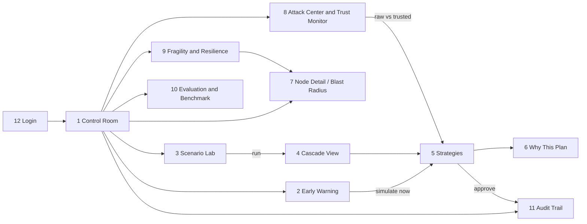

# 05 — UI Wireframes

12 screens, each with an ASCII wireframe, an interaction spec and a **"Computed by"** table naming the module that produces every number.

> **Illustrative-number convention:** every value in `‹angle quotes›` is a **placeholder for layout only** and is **not a real result**. In the product, every such value comes from the API field named in the screen's "Computed by" table (BRIEF rule 7, acceptance item 12). The ₹ figures follow the illustrative EV set in `ASSUMPTIONS.md` F-04.

---

## 0. Design tokens

### 0.1 Status colours (colour + icon, colour-blind safe)

| Token | Hex (light) | Hex (dark) | Icon | Meaning |
|---|---|---|---|---|
| `--status-ok` green | `#16A34A` | `#22C55E` | ● solid | Trusted entity / NORMAL mode / open link |
| `--status-warn` yellow | `#CA8A04` | `#EAB308` | ◐ half | Estimated entity / DEGRADED mode / degraded link / SUSPECTED inference |
| `--status-bad` red | `#DC2626` | `#EF4444` | ✕ cross | Quarantined / suspicious entity / failed node / blocked link / BLIND mode |
| `--status-sim` blue | `#2563EB` | `#3B82F6` | ◆ diamond | Simulated / predicted / future state (cascade, what-if) |
| `--status-recovery` teal | `#0D9488` | `#14B8A6` | ↻ | RECOVERY mode |
| `--status-stale` grey | `#6B7280` | `#9CA3AF` | ○ hollow | No data / stale beyond threshold |

### 0.2 Data-mode badges
`LIVE` (green outline), `REPLAY` (amber outline, with a tooltip showing the recording timestamp), `MOCK` (grey hatched, with the tooltip "pre-computed, not a live observation"). Every external-signal widget shows its badge.

### 0.3 Other tokens
Font: Inter (UI), JetBrains Mono (IDs and numbers). Spacing is on a 4 px grid. The dark control-room theme is the default, with a light theme available. The mode badge sits top-right on every screen. Uncertainty is drawn as translucent halos (position) and shaded bands (ETA / P10–P90).

### 0.4 Navigation map



---

## 1. Control Room (home)

```
┌──────────────────────────────────────────────────────────────────────────────────────────────┐
│ PNT1 Twin  [Control Room] Early Warning  Scenario Lab  Attack Center  Fragility  Eval  Audit  │
│                                                   sim 2026-10-12 14:05 ×60  ● NORMAL  op@team ▾│
├───────────────────────────────────────────────────────────┬──────────────────────────────────┤
│  MAP (MapLibre + deck.gl)          [☐ Freshness heatmap]   │ LIVE TELEMETRY  (computed)       │
│                                    [☐ EO flood MOCK]       │ Events/min        ‹5,240›        │
│      W-DEL●                                                │ Valid / invalid   ‹99.1% / 0.9%› │
│         ╲                       W-KOL●                     │ Anomalies  ✕‹3› ◐‹11›            │
│   W-AMD● ╲      W-NAG●         ╱                           │ Critical events   ‹1›            │
│      ╲    ╲    ╱      ╲       ╱                            │ Quarantined       ‹2› entities   │
│   W-BOM●──W-PNQ●     W-HYD●━━━━━━W-VGA◐                    │ Dead-letter       ‹14›           │
│              ╲        ┃  ▸▸▸ trucks  ╲                     │ Freshness         ‹97.8%›        │
│               ╲       ┃               P-VTZ●               │ Mode              ● NORMAL       │
│            W-BLR●━━━W-CHE●  P-CHE●                         │ (each row → drill-down)          │
│   legend: ● trusted ◐ estimated ✕ quarantined ○ stale      ├──────────────────────────────────┤
│           ━ open ┅ degraded ╳ blocked  ◆ simulated          │ TOP 3 ACTIONS NOW                │
│                                                            │ 1 ‹Reroute 38 shipments HYD→VGA› │
│                                                            │   [Open strategies]              │
│                                                            │ 2 ‹Review quarantine truck-A-017›│
│                                                            │ 3 ‹Transfer SKU-B W-BLR→W-HYD›   │
├───────────────────────────────────────────────────────────┴──────────────────────────────────┤
│ ALERT FEED (triaged)  ✕ 14:03 trust.anomaly truck-A-017 speed 812 km/h > 120 hard cap  [view] │
│                       ◐ 14:01 weather HYD-VGA p=‹0.71› in ‹8h›  LIVE                  [view] │
│                       ○ 13:58 feed S03 stale ‹6 min›                                  [view] │
└──────────────────────────────────────────────────────────────────────────────────────────────┘
```

**Interactions:**
- Click a node or link → side drawer summary → "Open detail" (screen 7). Click a truck → trust card popover.
- The freshness heatmap toggle recolours nodes and links by data age (grey→green gradient) and appears automatically in DEGRADED or BLIND.
- The mode badge is clickable → mode history and the F and C values.
- Each KPI in Live Telemetry links to its drill-down: anomaly list, quarantine queue (screen 8), DLQ viewer (Admin).
- The alert feed is deduplicated and ranked (F-47). "view" opens the relevant screen.
- In BLIND mode: red banner "BLIND — running on last trusted state, uncertainty growing", plus position halos.

**Computed by:** events/min, valid %, anomalies, critical, quarantined, DLQ, freshness → `pnt1.trust.kpis` (rolling 60 s window over the stream, F-95). Mode → `pnt1.trust.mode`. Top-3 actions → `pnt1.decision.triage`. The p in the alert → `pnt1.risk.corridor`. Node and link colours → `pnt1.twin` status + `pnt1.trust` class.

---

## 2. Early Warning

```
┌──────────────────────────────────────────────────────────────────────────────────────────────┐
│ EARLY WARNING                                        forecast source: Open-Meteo  [LIVE]      │
├─────────────────────────────────────┬────────────────────────────────────────────────────────┤
│ CORRIDOR RISK (next 12h)            │  MAP: forecast overlay (precip mm/h) on corridors      │
│ corridor        p      lead  trend  │                                                        │
│ ◐ HYD-VGA-NH65  ‹0.71› ‹8h›   ▲     │         W-HYD ━━━━━━(▓▓▓ heavy rain ▓▓▓)━━━ W-VGA      │
│ ◐ NH16S         ‹0.34› ‹11h›  ▲     │                                                        │
│ ● BLR-CHE       ‹0.06› —      ▬     │   time slider:  now ──●────────── +12h                 │
│ ● NH44S         ‹0.03› —      ▼     │                                                        │
├─────────────────────────────────────┴────────────────────────────────────────────────────────┤
│ HYD-VGA-NH65 detail                                                                          │
│ Drivers: 6h precip ‹92 mm› (IMD very heavy) · gusts ‹48 km/h› · ‹4/5› sample points > band   │
│ Probability  ‹71%›   ████████████████████░░░░░░░░   break-even p* ‹4.95%› ▏                 │
│ Flows on corridor: ‹38› shipments, ‹426› units in next 12h                                   │
│ Calibration: Platt v‹3›, Brier ‹0.12› ⓘ "calibrated against the simulated world, not         │
│              real-world history"                                                             │
│                                           [ Simulate now ▶ ]   [ Snooze 1h ]                 │
└──────────────────────────────────────────────────────────────────────────────────────────────┘
```

**Interactions:** selecting a corridor highlights it on the map. The time slider scrubs the forecast hours. "Simulate now" enqueues Monte Carlo for the four strategies and opens screen 5 with a progress bar. If Open-Meteo fails, the badge switches to `REPLAY` and shows the recording time.

**Computed by:** p, drivers → `pnt1.risk.corridor` (§8.2 model). p* → `pnt1.opt.ev` (after simulation; shown as "—" until it has been computed). Shipments and units on the corridor → `pnt1.twin.flows`. Brier → `pnt1.eval.calibration`.

---

## 3. Scenario Lab

```
┌──────────────────────────────────────────────────────────────────────────────────────────────┐
│ SCENARIO LAB                                                                                 │
├──────────────────────────────┬───────────────────────────────────────────────────────────────┤
│ SCENARIO TYPE                │ PARAMETERS: Port closure                                      │
│ (•) Port closure             │ Port        [ P-CHE ▾ ]                                       │
│ ( ) Warehouse failure        │ Start       [ T+0  ▾ ]   Duration [ 48 ] h                    │
│ ( ) Supplier failure         │ Severity    [━━━━━━━━━━●] 100 %                               │
│ ( ) Demand spike             │ Seed        [ 20261011 ] (auto)                               │
│ ( ) Extreme weather          │ Monte Carlo [☑] runs [200]                                    │
│ ( ) Fleet failure            │                                                               │
│ ( ) Fuel-cost shock          │ COMPOUND BUILDER                                              │
│                              │  1. Port closure P-CHE 48h             [✕]                    │
│ Saved scenarios ▾            │  2. Demand spike +60% SKU-B south 36h  [✕]                    │
│  BM-11 port closure          │  [+ add another disruption]                                   │
│  BM-14 compound              │  ☑ report interaction (combined − sum of parts)               │
│                              │                                                               │
│                              │                   [ Save ]   [ ▶ Run ]                        │
└──────────────────────────────┴───────────────────────────────────────────────────────────────┘
```

**Interactions:** the parameter form changes by type, with Pydantic-driven validation shown inline. Run → `POST /scenarios` + `/run` → Cascade View (screen 4) streams frames as they are computed. Saved benchmark scenarios are read-only (they are versioned).

**Computed by:** nothing numeric is displayed other than user inputs. The seed is generated by `pnt1.sim.seed`.

---

## 4. Cascade View

```
┌──────────────────────────────────────────────────────────────────────────────────────────────┐
│ CASCADE: Port closure P-CHE 48h + Demand spike   ◆ SIMULATED        run ‹r-8f2c›  MC 200     │
├──────────────────────────────────────────────────────────────────────────────────────────────┤
│ KPI RIBBON @ T+‹18h›  Delay ‹1,240 order-h›  Cost ‹₹7.8L›  Orders affected ‹212›            │
│                       Inventory at risk ‹3 nodes / 5 SKUs›   Interaction ‹+₹1.1L› (super-add.)│
├──────────────────────────────────────────────────────────────────────────────────────────────┤
│  GRAPH / MAP (blue = simulated state)                                                        │
│     P-CHE╳ ─ ─ ▶ W-CHE◆(▼ SKU-C 40%) ─ ─ ▶ F-SRI◆(output ▼) ─ ─ ▶ W-BLR◆ ─ ─ ▶ C-KOC◆       │
│                    ╲                                                                         │
│                     ─ ─ ▶ C-CHE◆ (stockout at T+‹18h›)                                       │
│  wavefront rings pulse outward from the failure; node fill = inventory vs safety stock       │
├──────────────────────────────────────────────────────────────────────────────────────────────┤
│ TIME SCRUBBER  T+0 ├───────────●──────────────────────────────────────────┤ T+72h  ▶ ⏸ 2×   │
│                   events: ▲T+2 inbound missed ▲T+10 F-SRI short ▲T+18 first stockout          │
├──────────────────────────────────────────────────────────────────────────────────────────────┤
│ [ Compare strategies ▶ ]      [ Blast radius of P-CHE ]      [ Export frames ]               │
└──────────────────────────────────────────────────────────────────────────────────────────────┘
```

**Interactions:** drag the scrubber or press play (frames are pre-computed at 1 h resolution and interpolated for animation). Hover a node → inventory sparkline over 72 h with P10–P90 band. Click an event marker → jump to that hour. "Compare strategies" → screen 5.

**Computed by:** all KPIs, frames, event markers and the interaction term → `pnt1.sim.cascade` (+ `pnt1.sim.montecarlo` for bands).

---

## 5. Strategies / Multi-Futures

```
┌──────────────────────────────────────────────────────────────────────────────────────────────┐
│ STRATEGIES for HYD-VGA heavy-rain warning        Objective: [ Balanced ▾ ]  (recalculates)   │
│ p(disruption) = ‹0.71› (LIVE forecast)      Solver: GLOP ‹optimal› in ‹0.8 s›  MC 200 runs   │
├───────────────────┬──────────────┬──────────────┬──────────────┬─────────────────────────────┤
│                   │ Do nothing   │ Reroute      │ Transfer     │ Hybrid  ★ recommended       │
├───────────────────┼──────────────┼──────────────┼──────────────┼─────────────────────────────┤
│ Expected cost     │ ‹₹6.75L›     │ ‹₹1.14L›     │ ‹₹2.30L›     │ ‹₹1.06L›                    │
│ Action cost C_a   │ ₹0           │ ‹₹42,000›    │ ‹₹61,000›    │ ‹₹55,000›                   │
│ Delay (mean)      │ ‹+14.2 h›    │ ‹+1.7 h›     │ ‹+3.9 h›     │ ‹+1.4 h›                    │
│ Stockout risk     │ ‹3 nodes›    │ ‹1 node›     │ ‹1 node›     │ ‹0 nodes›                   │
│ Orders saved      │ —            │ ‹171›        │ ‹120›        │ ‹183›                       │
│ CO₂               │ ‹12.1 t›     │ ‹13.0 t›     │ ‹12.6 t›     │ ‹12.9 t›                    │
│ Cost P50 / P90    │ ‹6.9L/9.1L›  │ ‹1.1L/1.6L›  │ ‹2.2L/3.4L›  │ ‹1.0L/1.4L›                 │
│ Robustness        │ ‹0.41 Low›   │ ‹0.88 Med›   │ ‹0.74 Med›   │ ‹0.93 High›                 │
│ Break-even p*     │ —            │ ‹4.95%›      │ ‹8.1%›       │ ‹6.6%›                      │
│ Exp. loss avoided │ —            │ ‹₹6.02L›     │ ‹₹4.9L›      │ ‹₹6.2L›                     │
├───────────────────┴──────────────┴──────────────┴──────────────┴─────────────────────────────┤
│ EV check: current p ‹71%›  ≫  p* ‹4.95%› → ACT            ⓘ C_a is paid even if no rain comes│
│ Constraint checks (hybrid): ✓ capacity ✓ safety stock ✓ deadlines ✓ driver hours ◐ 2 warnings │
│   [ Why this plan? ]      [ Modify… ]      [ Reject ]      [ ✔ Approve hybrid ]              │
└──────────────────────────────────────────────────────────────────────────────────────────────┘
```

**Interactions:** changing the objective preset re-runs the optimizer (≤ 5 s) and the MC evaluation (≤ 15 s), with skeleton loading. Clicking a column header shows that strategy's routes on a mini-map. **Modify…** opens a dialog: exclude links, change deadlines, pin SKUs → recompute. **Approve** requires the Operator role and asks for confirmation ("This will reroute ‹38› shipments") → audit entry → toast with the audit ID. When a recommendation came from an attack scenario, a "Raw vs trusted" tab appears (screen 8C).

**Computed by:** costs, delay, stockouts, orders saved, CO₂ → `pnt1.sim.montecarlo` evaluating `pnt1.opt` plans. P50/P90 and robustness → `pnt1.sim.montecarlo`. C_a, p*, expected loss avoided, EV verdict → `pnt1.opt.ev`. Constraint checks → `pnt1.opt.checks`. Solver status/time → `pnt1.opt.solver`.

---

## 6. Why This Plan (explanation panel)

```
┌──────────────────────────────────────────────────────────────────────────────────────────────┐
│ WHY THIS PLAN: Hybrid (Balanced objective)          narrative source: [Claude] / [template]  │
├──────────────────────────────────────────────────────────────────────────────────────────────┤
│ CONSTRAINT CHECKS                                                                            │
│ ✓ Link capacity        L055 Khammam at ‹84%› of ‹900›/day                                    │
│ ✓ Warehouse capacity   W-VGA ‹71%›                                                           │
│ ✓ Safety stock         all nodes ≥ safety stock through T+72h                                │
│ ✓ Deadlines            ‹183/190› P1–P2 orders on time                                        │
│ ◐ Driver hours         ‹2› drivers reach ‹10.5h› (limit 11h), reassigned by F-80             │
│ ✕ Cheapest route (NH65) rejected: causes stockout of SKU-B at W-VGA at T+‹20h›               │
├──────────────────────────────────────────────────────────────────────────────────────────────┤
│ TRUST EVIDENCE USED                                                                          │
│ • W-HYD SKU-B inventory: Estimated (τ ‹0.72›), discounted to ‹72%› in the optimizer           │
│ • truck-A-017 quarantined, excluded from fleet assignment                                    │
├──────────────────────────────────────────────────────────────────────────────────────────────┤
│ NARRATIVE (explains, never decides)                                                          │
│ "‹Heavy rain is forecast on NH65 with a 71% chance of disruption. Splitting flow between the │
│  Khammam road and rail keeps every warehouse above safety stock and costs ₹55,000, which is  │
│  worth it above a 6.6% chance of disruption…›"                                               │
│ ✓ all ‹7› numbers in the narrative match the optimizer output                                │
└──────────────────────────────────────────────────────────────────────────────────────────────┘
```

**Interactions:** each constraint row expands to show the binding constraints and their shadow prices (LP duals). "narrative source" shows `template` when the LLM is unavailable or fails validation. There is no free-text chat.

**Computed by:** checks → `pnt1.opt.checks`. Trust evidence → `pnt1.trust` snapshot stored in the recommendation. Narrative → `pnt1.explain` (LLM or template). Number validation → `pnt1.explain.validator`.

---

## 7. Blast Radius / Node Detail (with trust card)

```
┌──────────────────────────────────────────────────────────────────────────────────────────────┐
│ NODE W-VGA: Vijayawada hub · Warehouse · ● open · health ‹0.97›   [ Simulate failure ▶ ]     │
├───────────────────────────────────┬──────────────────────────────────────────────────────────┤
│ DEPENDENCY TREE (if W-VGA fails)  │ EXPOSURE (single-cascade estimate, ◆ simulated)          │
│ W-VGA                             │ Direct affected     ‹3› (C-VGA, C-VTZ, C-BHU)            │
│ ├─ C-VGA   (primary)              │ Indirect affected   ‹2›                                  │
│ ├─ C-VTZ   (ONLY source ✕)        │ Orders at risk      ‹96›                                 │
│ └─ C-BHU   (secondary)            │ Revenue exposure    ‹₹19.2L›                             │
│ inbound: W-HYD (3 links), W-CHE,  │ Recovery time       ‹31 h›                               │
│          S07, P-VTZ               │ Articulation point  YES for C-VTZ                        │
├───────────────────────────────────┴──────────────────────────────────────────────────────────┤
│ INVENTORY CONFIDENCE                                                                         │
│ SKU   reported  verified  safety  class        confidence                                    │
│ SKU-A ‹1,820›   ‹1,812›   ‹600›   ● Verified   ‹0.96›                                        │
│ SKU-B ‹940›     ‹655›     ‹300›   ◐ Estimated  ‹0.70›  reason: Δqty ≠ recorded flows (‹+30%›)│
│ SKU-C ‹410›     ‹0›       ‹200›   ✕ Suspicious ‹0.31›  reason: feed_corrupt suspected        │
├──────────────────────────────────────────────────────────────────────────────────────────────┤
│ TRUST CARD: feed wh:W-VGA          τ ‹0.70›  ◐ Estimated                                      │
│ Schema ‹1.00› Range ‹1.00› Flow-reconciliation ‹0.40› Temporal ‹1.00› Statistical ‹0.62›     │
│ Context ‹0.80› (EO flood mask: MOCK)                                                          │
│ Failed checks: flow-reconciliation (Δ ‹+285› units vs recorded in/out)                       │
│ Trust over time  ▁▁▁▁▁▁▁▂▂▂▃▅▇▇▇▇  (last 6h)                                                  │
└──────────────────────────────────────────────────────────────────────────────────────────────┘
```

**Interactions:** "Simulate failure" runs a single cascade for this node → Cascade View. Clicking a dependency highlights paths on the map. The trust card timeline links to the relevant `trust_history` rows. For a **vehicle** entity, the trust card shows all 8 check families (S, P, K, N "Geospatial / road-network match", R, T, A, C).

**Computed by:** dependency tree, articulation flag → `pnt1.graph.blast_radius` / `fragility`. Exposure, orders at risk, recovery → `pnt1.sim.cascade` (single run). Inventory columns → `pnt1.twin.inventory` (+ `pnt1.trust` confidence). Trust card → `pnt1.trust` (`trust_state`, `trust_history`).

---

## 8. Attack Center & Trust Monitor

### 8A. Inject controls (all 10 injectors from T-06, plus node failure)

```
┌──────────────────────────────────────────────────────────────────────────────────────────────┐
│ ATTACK CENTER   ⚠ guided mode, Operator only, every injection is audit-logged                  │
├──────────────────────────────────────────────────────────────────────────────────────────────┤
│ INJECTOR                  TARGET                     PARAMS                    ACTION         │
│ gps_spoof_teleport        [truck-A-017 ▾]            to [sea ▾]                [Inject]       │
│ gps_spoof_drift           [truck-B-004 ▾]            ‹0.15› km / 5 min         [Inject]       │
│ speed_spike               [truck-A-017 ▾]            ‹812› km/h                [Inject]       │
│ inventory_fake            [W-HYD ▾][SKU-B ▾]         ‹+40›%                    [Inject]       │
│ feed_corrupt              [S03 feed ▾]               types+units               [Inject]       │
│ payload_incomplete        [FLEET-C ▾]                ‹30›% of msgs             [Inject]       │
│ duplicate_replay          [FLEET-A ▾]                last ‹10› min             [Inject]       │
│ entity_blackout           [W-VGA feed ▾]             ‹60› min                  [Inject]       │
│ mass_blackout             [all ▾]                    ‹70›% for ‹20› min        [Inject]       │
│ coordinated_stop_spoof    [L053 ▾][FLEET-A ▾]        ‹8› trucks, ‹20› min      [Inject]       │
│ node_failure              [P-CHE ▾]                  ‹48› h                    [Inject]       │
│ Active injections: speed_spike truck-A-017 (T+0:42)                  [Stop all]              │
└──────────────────────────────────────────────────────────────────────────────────────────────┘
```

### 8B. "Inject telemetry anomaly" result panel (ADD §6.2; appears within seconds)

```
┌──────────────────────────────────────────────────────────────────────────────────────────────┐
│ ① RAW VALUE      truck-A-017 reported speed 812 km/h   (expected max 100, hard cap 120)      │
│ ② FAILED CHECKS  ✕ Range/physics 0.00 (812 > 120)   ✕ Kinematic ‹0.10› (implied ‹61› km/h)  │
│                  ● Geospatial / road-network match ‹0.90›   ● Route ‹0.85›                    │
│ ③ TRUST          reading ρ: avg ‹0.53› → hard-fail cap → 0.20                                │
│                  entity τ: ‹0.93› ● Trusted  →  ‹0.20› ✕ Quarantined                          │
│ ④ ACTION         reading quarantined · last trusted position restored (‹14:02:31›)           │
│                  position uncertainty ‹0.05› km → growing · ETA of shipment ‹S-19› degraded   │
│ ⑤ OPTIMIZER      decision inputs changed? ‹No› → no re-run (avoids alert storm)              │
│                  (if Yes: before/after plan comparison appears here)                         │
└──────────────────────────────────────────────────────────────────────────────────────────────┘
```

### 8C. Trust Monitor + quarantine queue + raw-vs-trusted

```
┌──────────────────────────────────────┬───────────────────────────────────────────────────────┐
│ QUARANTINE QUEUE                     │ PER-ENTITY TRUST (select up to 5)                     │
│ ✕ truck-A-017  speed_spike  14:03    │ 1.0 ┤━━━━━━━━━━━━━━━┓            ┏━━━━━ truck-B-022  │
│    [confirm attack] [false positive] │ 0.8 ┤- - - - - - - -┃- - - - - - ┃- - - trusted      │
│ ✕ S03 feed     schema/range  13:51   │ 0.5 ┤- - - - - - - -┃- - - - - - ┃- - - quarantine   │
│ ◐ W-HYD SKU-B  flow mismatch 13:40   │ 0.2 ┤               ┗━━━━━━━━━━━━┛  truck-A-017        │
│                                      │     └──────────────────────────────── time            │
├──────────────────────────────────────┴───────────────────────────────────────────────────────┤
│ RAW vs TRUSTED DECISION (F-17)                     scenario: inventory_fake W-HYD SKU-B      │
│                      Plan from RAW data       Plan from TRUSTED data                         │
│ Transfers to W-HYD   ‹0 units›               ‹420 units from W-BLR›                          │
│ Stockouts (sim)      ‹2 nodes at T+26h›      ‹0›                                             │
│ Expected cost        ‹₹4.1L›                 ‹₹0.9L›                                         │
│ → "The optimizer WOULD HAVE CHOSEN WORSE with the attacked data: ‹₹3.2L› more expected cost" │
└──────────────────────────────────────────────────────────────────────────────────────────────┘
```

**Interactions:** Inject → `POST /world/attacks` → the result panel (8B) subscribes to `trust.anomaly` for that entity and fills steps ①–⑤ as events arrive. Quarantine review buttons write `review_status` and an audit entry. "Raw vs trusted" → `POST /compare/raw-vs-trusted`. The Security Analyst sees the `coordinated_anomaly` alerts here.

**Computed by:** raw value → the injected envelope (`telemetry_raw`). Checks, ρ, τ, class, reasons → `pnt1.trust`. Action and uncertainty → `pnt1.twin`. "Decision inputs changed" → `pnt1.opt.relevance`. Raw-vs-trusted numbers → `pnt1.opt` + `pnt1.sim.montecarlo`.

---

## 9. Fragility & Resilience Report

```
┌──────────────────────────────────────────────────────────────────────────────────────────────┐
│ FRAGILITY & RESILIENCE          computed on current topology · ‹14:00›      [Recompute]       │
├──────────────────────────────────────────────┬───────────────────────────────────────────────┤
│ RESILIENCE SCORE  ‹64 / 100›                 │ CRITICAL NODES (ranked)                       │
│ ▸ Recovery            ‹0.58›  (25%)          │ # node   why                      downstream  │
│ ▸ Redundancy          ‹0.52›  (25%)          │ 1 W-VGA  articulation for C-VTZ   ‹11%›       │
│ ▸ Inventory buffer    ‹0.71›  (20%)          │ 2 W-HYD  betweenness ‹0.31›       ‹17%›       │
│ ▸ Supplier diversity  ‹0.66›  (15%)          │ 3 P-CHE  min-cut SKU-C → south    ‹9%›        │
│ ▸ Transport diversity ‹0.80›  (15%)          │ 4 W-DEL  betweenness ‹0.22›       ‹21%›       │
│ (click a row → contributors)                 │                                               │
├──────────────────────────────────────────────┴───────────────────────────────────────────────┤
│ MIN-CUT  SKU-C suppliers → C-KOC : cut {L088, L090} capacity ‹2,700›/day vs demand ‹1,900›    │
├──────────────────────────────────────────────────────────────────────────────────────────────┤
│ WHAT WOULD IMPROVE RESILIENCE?                                                               │
│ Add link [W-CHE ▾] → [C-VTZ ▾] mode [road ▾]            [Simulate]                           │
│ Result: score ‹64› → ‹69› (+‹5›), W-VGA no longer an articulation point for C-VTZ            │
└──────────────────────────────────────────────────────────────────────────────────────────────┘
```

**Interactions:** a sub-score row expands to show the contributing nodes and pairs. A critical-node row opens Node Detail. The what-if runs on a graph copy and never changes the twin.

**Computed by:** everything → `pnt1.graph` (fragility, min-cut, resilience, what-if). Recovery sub-score uses `pnt1.sim.cascade` single-node runs (cached).

---

## 10. Evaluation & Benchmark

```
┌──────────────────────────────────────────────────────────────────────────────────────────────┐
│ EVALUATION: twin vs ground truth         benchmark run ‹b-2026-10-19› git ‹a1b2c3d› seeds ✓  │
├───────────────┬───────────────┬───────────────┬───────────────┬──────────────────────────────┤
│ ETA MAE       │ Inventory MAPE│ Stockout P / R│ Decision regret│ Calibration (Brier / ECE)   │
│ ‹38 min›      │ ‹3.1%›        │ ‹0.71 / 0.86› │ ‹+4.2%› vs     │ ‹0.12 / 0.04›               │
│ target ≤ 45   │ target ≤ 5%   │ R ≥ 0.80      │ oracle         │ ⓘ internal (simulated world)│
├───────────────┴───────────────┴───────────────┴───────────────┴──────────────────────────────┤
│ RESILIENCE BENCHMARK                                                                         │
│ ID    scenario               DR     FPR    TTD     TTR     Regret  Mode acc  Crash  Pass     │
│ BM-01 GPS teleport           ‹100%› ‹0.3%› ‹1 rd›  ‹9 min› ‹0.4%›  ‹99%›     0      ✓        │
│ BM-02 GPS drift              ‹80%›  ‹0.3%› ‹34 m›  …       …       …         0      ✓        │
│ BM-10 coord. stop spoof      …  false reroutes ‹0›  alert ✓                   0      ✓        │
│ …     (15 rows)                                                                              │
│ Σ     overall                                                          0      ‹14/15›        │
├──────────────────────────────────────────────────────────────────────────────────────────────┤
│ DRIFT (rolling 1h ETA MAE)  ▂▂▂▃▂▂▂▅▆▃▂▂  (spike = blackout, recovered)   [Run benchmark ▶]   │
│ Per-injector matrix ▸                                                                        │
└──────────────────────────────────────────────────────────────────────────────────────────────┘
```

**Interactions:** "Run benchmark" (Admin) enqueues the full suite and shows progress per scenario. A row expands to show per-metric detail and links to the scenario's audit trail and replay. The calibration card opens the reliability diagram.

**Computed by:** everything → `pnt1.eval` (fidelity, decision, security, calibration, drift, bench) from the `truth` + `twin` data.

---

## 11. Audit Trail

```
┌──────────────────────────────────────────────────────────────────────────────────────────────┐
│ AUDIT TRAIL          filter: [type ▾] [actor ▾] [date range]        chain integrity ✓ verified│
├──────┬──────────┬───────────────┬──────────────┬─────────────────────────────────────────────┤
│ seq  │ time     │ type          │ actor        │ summary                                     │
│ 1042 │ 14:07:12 │ decision      │ op@team      │ approved hybrid rec ‹R-77› (HYD-VGA rain)   │
│ 1041 │ 14:06:58 │ recommendation│ system       │ R-77 · Balanced · GLOP optimal · cfg ‹9f3e›  │
│ 1039 │ 14:03:05 │ quarantine    │ trust-engine │ truck-A-017 speed_spike ρ 0.20              │
│ 1031 │ 13:40:00 │ mode_change   │ trust-engine │ NORMAL → DEGRADED (F ‹88%›)                 │
├──────┴──────────┴───────────────┴──────────────┴─────────────────────────────────────────────┤
│ DETAIL 1042 → inputs snapshot · trust snapshot · optimizer ‹v0.3.1› · config ‹9f3e› · approver│
│ [ Replay decision ▶ ]  result: plan identical ✓ (or diff shown)                               │
└──────────────────────────────────────────────────────────────────────────────────────────────┘
```

**Interactions:** replay re-runs the optimizer on the stored snapshots (F-64). If the config or version has changed since, both results are shown side by side. Integrity verification recomputes the hash chain. Export to JSON is Admin only.

**Computed by:** `pnt1.decision.audit` (entries, chain verification, replay).

---

## 12. Login / Role switch (minimal)

```
┌──────────────────────────────────────────┐
│            PNT1 Logistics Twin           │
│  Email     [__________________________]  │
│  Password  [__________________________]  │
│                     [ Sign in ]          │
│  ─────────────── presentation ───────────────    │
│  Role switch (presentation build only):          │
│  ( ) Viewer  (•) Operator  ( ) Admin     │
└──────────────────────────────────────────┘
```

**Interactions:** `POST /auth/login` → JWT. 5 failed attempts per IP per minute → 429. The role switch appears only when `GUIDED_MODE=true`: it signs in as pre-seeded presentation users (the credentials live in the seed file, not in the UI). Menu items and buttons the user's role does not allow are hidden, and the API enforces this as well.

---

## 13. Screen → requirement coverage

| Screen | Requirements |
|---|---|
| 1 Control Room | F-02, F-04, F-05, F-14, F-47, F-95 |
| 2 Early Warning | F-20, F-21, F-23, F-43 |
| 3 Scenario Lab | F-30, F-33 |
| 4 Cascade View | F-31, F-35, F-33 |
| 5 Strategies | F-34, F-40, F-41, F-42, F-43, F-44, F-80, F-81 |
| 6 Why This Plan | F-45, F-40 |
| 7 Node Detail | F-15, F-32, F-50, F-92 |
| 8 Attack Center & Trust Monitor | F-13, F-16, F-17, F-91, F-92, F-94, T-06 |
| 9 Fragility | F-50, F-51, F-52 |
| 10 Evaluation | F-61, F-62, F-63, F-66 |
| 11 Audit | F-64, F-65 |
| 12 Login | F-70 |
