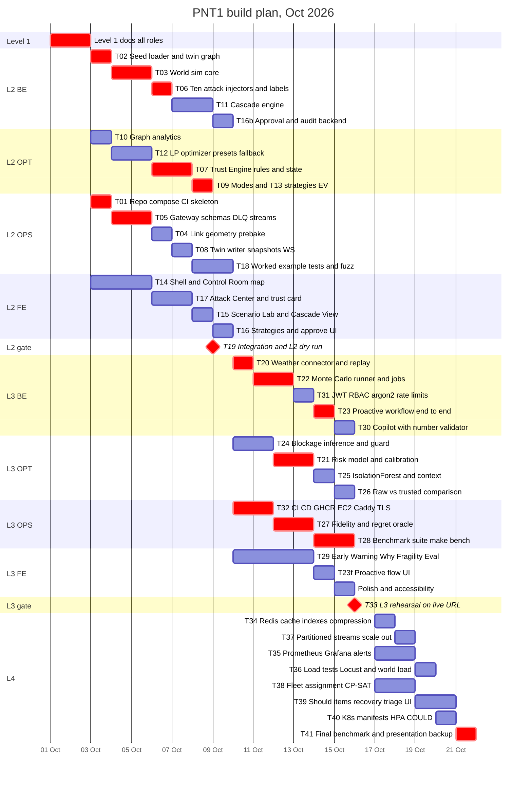

# 07 — Roadmap

**Team (ASSUMPTIONS A-01):** **BE** = Backend/Simulation · **OPT** = Optimization/ML · **FE** = Frontend · **OPS** = DevOps/QA.
**Calendar (A-02):** L1 01–02 Oct · L2 03–09 Oct · L3 10–16 Oct · L4 17–21 Oct 2026.
**Capacity (A-03):** about 8 focused hours per person per day during the hackathon, i.e. 56 h per person for L2 and L3 and 40 h for L4. Estimates below are in person-hours.

**Build order (BRIEF §12, with ADD §10 applied):** the telemetry simulator and attack injectors come first, because they are on the critical path for both the trust presentation and the benchmark. The Trust Engine comes right after the simulator and gateway.

---

## 1. Level map and exit criteria

| Level | Focus | Exit criteria (all must hold) |
|---|---|---|
| **1** | Docs | All BRIEF §1 deliverables exist and pass BRIEF §14 and ADD §11 (`LEVEL1_CHECKLIST.md`). |
| **2** | MVP vertical slice (local) | `docker compose up` on a laptop gives: seed network live on the map; world sim at ≥ 5k events/min; gateway + DLQ; Trust Engine rules with quarantine visible in the UI; degradation modes; fragility report; single cascade with scrubber; LP optimizer with presets and 4 strategies; approve → audit entry. The fuzz test passes. Worked-example unit tests pass. |
| **3** | Intelligence, security, deployment | Weather layer (LIVE + REPLAY) → calibrated p → Monte Carlo → EV trigger (UC-02 end to end); blockage inference + guard; IsolationForest check; raw-vs-trusted; evaluation + 15-scenario benchmark via `make bench`; Copilot with number validation; JWT + RBAC + argon2 + rate limits; TLS; CI/CD to a **live cloud URL**. |
| **4** | Scale and reliability | Redis caching and query optimisation (with EXPLAIN evidence); Prometheus + Grafana + ≥ 5 alert rules firing in a test; Locust + world load mode results (NFR-01 L4, NFR-03 L4, NFR-22); partitioned streams with ingest-worker scale-out; fleet assignment (S); optional K8s + HPA. |

---

## 2. Gantt chart (`crit` = critical path)



---

## 3. Task table

| ID | Task | Owner | Est (h) | Depends on | Level | Requirements |
|---|---|---|---|---|---|---|
| T01 | Mono-repo scaffold, `compose.yml` (postgres, redis), lint + test CI skeleton, import-linter contracts | OPS | 6 | — | L2 | F-72 (base), NFR-18 |
| T02 | Seed network loader (YAML → DB → NetworkX MultiDiGraph), `/twin/snapshot` read | BE | 6 | T01 | L2 | F-01, HL2-1 |
| T03 | World sim core: kinematics on link geometry, inventory flows, demand/orders, ports, shipment telemetry, seeded clock (60×), load mode | BE | 16 | T02 | L2 | T-01…T-05, F-60 |
| T04 | Pre-bake link LineStrings (OSRM export → seed), STRtree index | OPS | 6 | T02 | L2 | F-12a |
| T05 | Ingestion gateway: envelope + signal JSON Schemas, size and batch limits, source keys, DLQ, Redis Streams bus adapter, raw hypertable | OPS | 12 | T01 | L2 | F-03, F-90, F-96, F-98 |
| T06 | 10 attack injectors + command log + `truth.observation_label` writes | BE | 8 | T03 | L2 | T-06, T-08 |
| T07 | Trust Engine: checks S/P/K/N/R/T, hard cap, CUSUM, entity state machine, reasons, quarantine path, `trust.anomaly` | OPT | 16 | T05 (T04 when ready) | L2 | F-10, F-11, F-12a, F-13, F-91 |
| T08 | Twin writer (trusted/estimated apply, uncertainty growth), snapshots, WS diff channel | OPS | 8 | T05, T07 interface | L2 | F-02, F-13 |
| T09 | Freshness + mode controller (NORMAL/DEGRADED/BLIND/RECOVERY) + reconciliation | OPT | 4 | T07 | L2 | F-14 |
| T10 | Graph analytics: articulation points (global and per cluster), betweenness, min-cut, blast radius | OPT | 8 | T02 | L2 | F-32, F-50 |
| T11 | Cascade engine (1 h × 72 h, compound, frames) | BE | 14 | T02 | L2 | F-30, F-31, F-33 |
| T12 | LP optimizer (GLOP), presets, trust discount, constraint checks, heuristic fallback, 5 s limit | OPT | 16 | T02 | L2 | F-40, F-41 |
| T13 | Strategy generation (4 futures) + basic EV trigger (single-run L₀/L₁) | OPT | 4 | T11, T12 | L2 | F-42, F-43 |
| T14 | Next.js shell, auth stub, Control Room map (MapLibre + deck.gl), Live Telemetry panel, alert feed | FE | 22 | T02 (mock API first) | L2 | F-04, F-95 |
| T15 | Scenario Lab + Cascade View + time scrubber | FE | 8 | T11, T14 | L2 | F-30, F-35 |
| T16 / T16b | Strategies screen + Approve/Modify UI / decision API, hash-chained audit, outbox | FE 8 / BE 8 | 16 | T13 | L2 | F-44, F-64 |
| T17 | Attack Center (all injectors), inject result panel, trust card, quarantine queue | FE | 14 | T07, T14 | L2 | F-16, F-92 |
| T18 | Unit tests for worked examples A–D, EV example, Hypothesis fuzz (10k in CI) | OPS | 12 | T07 | L2 | TS-TRUST-01..04, TS-FUZZ-01 |
| T19 | Integration + L2 dry run (all roles, 2 h each) | ALL | 8 | all L2 | L2 | HL2-4 |
| T20 | Open-Meteo connector, corridor sample points, replay cache, GDACS poller (S) | BE | 8 | T19 | L3 | F-20, F-21 |
| T21 | Risk model (logistic prior), Platt calibration against world labels, reliability report | OPT | 12 | T20 | L3 | F-20 |
| T22 | Monte Carlo runner (200 runs, CRN), robustness, arq job worker, progress events | BE | 14 | T11 | L3 | F-34 |
| T23 / T23f | Proactive workflow end to end (UC-02) backend / UI | BE 6 / FE 8 | 14 | T21, T22, T13 | L3 | UC-02, F-43 |
| T24 | Blockage inference: clustering, quorum, independence, corroboration, contradiction, SUSPECTED flow | OPT | 12 | T07 | L3 | F-93, F-94 |
| T25 | IsolationForest statistical check + context check (weather/alert/gate scan) | OPT | 8 | T07, T20 | L3 | F-12b, F-91 |
| T26 | Raw-vs-trusted comparison endpoint + UI tab | OPT | 6 | T12, T07, T17 | L3 | F-17 |
| T27 | Evaluation service: fidelity metrics, oracle optimizer, regret, calibration metrics | OPS | 14 | T06, T12 | L3 | F-61, F-62 |
| T28 | Benchmark suite BM-01..BM-15, `make bench`, results table + per-injector matrix | OPS | 14 | T27, T24 | L3 | F-63 |
| T29 | Early Warning, Why This Plan, Fragility, Evaluation, Audit, Node Detail screens | FE | 30 | T19 | L3 | F-20, F-45, F-50, F-61…64 |
| T30 | Copilot: Claude call, strict JSON input, number validator, template fallback, caching | BE | 6 | T13 | L3 | F-45 |
| T31 | JWT + RBAC + argon2id + login rate limit + source-key admin | BE | 8 | T19 | L3 | F-70, F-71 |
| T32 | GitHub Actions build/push (GHCR), EC2 provisioning, Caddy TLS, SSH deploy, secrets, gitleaks | OPS | 14 | T01 | L3 | F-72, F-71 |
| T33 | L3 rehearsal on the live URL + bug-fix buffer | ALL | 8 | all L3 | L3 | HL3-4 |
| T34 | Redis snapshot/analytics cache, index review with EXPLAIN, Timescale compression | BE | 8 | T33 | L4 | F-73 |
| T35 | Prometheus metrics, Grafana dashboards, Alertmanager rules (≥ 5), alert-fire test | OPS | 14 | T33 | L4 | F-74 |
| T36 | Locust API load + world load mode (50k/min), scale-out measurement | OPS 8 / BE 4 | 12 | T34, T37 | L4 | NFR-01, NFR-03, NFR-22 |
| T37 | Partitioned `ev.raw.{p}` streams, entity-affinity consumers | BE | 8 | T33 | L4 | NFR-22 |
| T38 | Fleet assignment (CP-SAT) + driver-hours warnings | OPT | 14 | T12 | L4 | F-80, F-81 |
| T39 | SHOULD items: recovery planner, alert triage top-3, resilience score + what-if, freshness heatmap, inventory confidence UI | OPT 10 / FE 16 | 26 | T19 | L4 | F-46, F-47, F-51, F-52, F-05, F-15 |
| T40 | K8s manifests + HPA on kind (**COULD**) | OPS | 8 | T35 | L4 | F-75 |
| T41 | Final benchmark run, results committed, recorded recorded walkthrough fallback | ALL | 8 | all | L4 | F-63, R-09 |

**Load check (hours per person):**

| Role | L2 | L3 | L4 |
|---|---|---|---|
| BE | T02 6 + T03 16 + T06 8 + T11 14 + T16b 8 + T19 2 = **54** / 56 | T20 8 + T22 14 + T23 6 + T30 6 + T31 8 + T33 2 = **44** / 56 | T34 8 + T37 8 + T36 4 = **20** / 40 |
| OPT | T07 16 + T09 4 + T10 8 + T12 16 + T13 4 + T19 2 = **50** / 56 | T21 12 + T24 12 + T25 8 + T26 6 + T33 2 = **40** / 56 | T38 14 + T39 10 = **24** / 40 |
| OPS | T01 6 + T04 6 + T05 12 + T08 8 + T18 12 + T19 2 = **46** / 56 | T27 14 + T28 14 + T32 14 + T33 2 = **44** / 56 | T35 14 + T36 8 + T40 8 = **30** / 40 |
| FE | T14 22 + T15 8 + T16 8 + T17 14 + T19 2 = **54** / 56 | T23f 8 + T29 30 + T33 2 + polish 8 = **48** / 56 | T39 16 + polish 8 = **24** / 40 |

L3 and L4 have 8–20 h of slack per role on purpose. That is the bug-fix buffer, and T41 needs it.

---

## 4. Critical path

```
T01 → T05 (gateway) ─┐
T02 → T03 (world) → T06 (injectors) ─┴→ T07 (Trust Engine) → T19 (L2 gate)
     → T20 (weather) → T21 (risk p) ─┐
       T11 → T22 (Monte Carlo) ──────┴→ T23 (proactive E2E)
     → T27 (fidelity + oracle) → T28 (benchmark) → T33 (L3 gate, needs T32 live URL) → T41
```

**Why this path:** the world simulator and injectors (T03, T06) feed the Trust Engine *and* the benchmark labels, and the benchmark (T28) is the PROVE story. Without the simulator there is no trust presentation and no evaluation (ADD §10). The proactive workflow (T20 → T21 → T23) is the canonical presentation beat and depends on Monte Carlo (T22). The live URL (T32) gates Level 3.

**Risk controls on the path:** T14 starts with a mocked API (typed from OpenAPI stubs), so FE is never blocked. T07 starts with straight-line geometry while T04 lands. T12 and T11 depend only on the seed graph snapshot, not on live telemetry.

---

## 5. Cut-lines (drop in this order if time runs short)

| Order | Cut | Impact | Keeps |
|---|---|---|---|
| 1 | **K8s + HPA** (T40, F-75) | None on the presentation. Compose `--scale` still shows the scaling design | Compose scale-out |
| 2 | **EO flood imagery** overlay (F-23) | Loses one `MOCK` context layer | Weather and alerts context |
| 3 | **AIS** replay (F-22, F-12c) | Port congestion comes from port telemetry only | Port telemetry |
| 4 | **Counterfactual replay** (F-65) | Loses the "6 h earlier" story | Decision replay (F-64) |
| 5 | **LLM explanations** (F-45) | Narrative comes from the deterministic template | Constraint checks panel |
| 6 | **Extra scenarios**: fleet failure, fuel shock, supplier failure | The Scenario Lab lists fewer types | Port closure, weather, demand spike, warehouse failure |
| 7 | Fleet assignment (F-80/81), recovery planner (F-46), resilience what-if (F-51) | S-level features absent | Routing + inventory optimizer (MUST) |
| 8 | IsolationForest (A) and context (C) checks | Weights renormalise over the M checks | All hard checks + CUSUM |

**Never cut (the vertical slice):** world simulator + injectors, gateway + DLQ, Trust Engine with hard cap, quarantine, degradation modes, blockage guard, cascade + scrubber, LP optimizer + 4 strategies + EV trigger, approve + audit, raw-vs-trusted, evaluation + benchmark table, auth + TLS + CI/CD live URL (L3).

---

## 6. Working agreements
- Trunk-based development with short-lived branches. PRs need 1 review. CI must be green (lint, types, tests, 10k fuzz).
- Contracts first: the OpenAPI and event schemas from `04_DATA_MODEL.md` are committed on day 3, before implementation.
- Daily 15-minute sync, and a presentation-path smoke run every evening from day 7 onwards.
- Every UI number must reference an API field (review checklist item).
